# Restaurant Dish Sales Analysis (2018-2019)

**Excel pivot tables + Python | Sales performance review**

A restaurant group's sales log of **909 transactions** over two years (2018-01-06 to 2019-12-30): 12 salespeople, 5 dish categories, 4 Ghanaian regions and 5 corporate customers. The original Excel project built a pivot-table dashboard with slicers. This repository validates that work, fixes what it got wrong, and turns it into a business review with findings and recommendations.

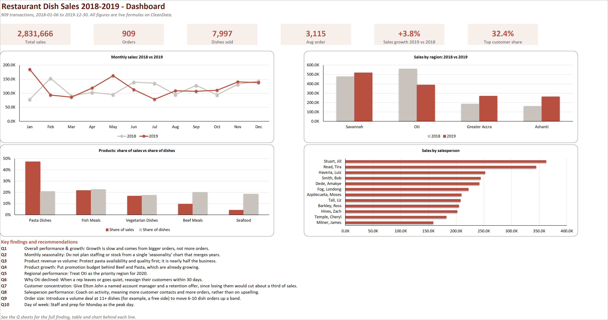

## Headline numbers

| Metric | Value |
|---|---|
| Total sales | 2,831,665.67 |
| Transactions | 909 |
| Dishes sold | 7,997 |
| Average transaction | 3,115.14 |
| Customers / products / salespeople / regions | 5 / 5 / 12 / 4 |
| Sales 2018 to 2019 | 1,389,110.80 to 1,442,554.87 (+3.8%) |

Currency: not stated in the source workbook, so values are shown without a symbol.

## Business questions

| # | Question |
|---|---|
| Q1 | How much did the restaurant sell over 2018-2019, and did sales grow? |
| Q2 | Is there a reliable monthly seasonal pattern? |
| Q3 | Which dishes drive revenue, and is that price or volume? |
| Q4 | Which dishes grew or shrank from 2018 to 2019? |
| Q5 | Which regions sell the most, and how did they change? |
| Q6 | What explains the Oti decline? Which salespeople grew or declined? |
| Q7 | How dependent are we on a few customers? |
| Q8 | Who are the top salespeople, and what makes them top? |
| Q9 | What size are typical orders, and where does the money come from? |
| Q10 | Which days of the week do orders come in? |

The data has **no cost, profit or discount fields**, so margin and discount questions cannot be answered. The analysis covers revenue, volume (dishes), mix and concentration.

## Process

1. **Inspect** the original workbook: sheets, pivot tables, pivot cache, charts, slicers, formulas and named ranges.
2. **Validate** the raw table: blanks, duplicates, date validity, value range and category labels.
3. **Clean**: trim labels, round sales to cents, add date parts, and derive unit price and dishes per order.
4. **Reconcile** every original pivot total against the cleaned data.
5. **Analyse** each business question in Excel (live formulas) and in Python (notebook).
6. **Communicate**: dashboard, stakeholder deck, and this README.

## Data validation and cleaning

| Check | Result |
|---|---|
| Rows | 909 |
| Blank cells | 0 |
| Exact duplicate rows | 0 |
| Invalid dates | 0 (range 2018-01-06 to 2019-12-30) |
| Zero or negative sales | 0 |
| Product labels with a trailing space | **370 rows** ('Fish Meals ', 'Vegetarian Dishes '): trimmed |
| Floating-point noise (e.g. 3068.5499999) | rounded to 2 decimals |
| Sales are whole multiples of one unit price | yes: 1 to 20 dishes per order, so a Units column was derived |
| Salesperson in two regions | Azpilecueta, Moses |
| Saturday orders | only 2 in two years |

**Unit prices derived from the data:** Beef Meals 168.95, Fish Meals 340.95, Pasta Dishes 799.95, Seafood 79.99, Vegetarian Dishes 340.95.

**Issues found in the original workbook:**

- The helper table at `Data!AG6:AO18` is broken: its **55 SUMIFS formulas** use a `#REF!` criteria range (a deleted column) and sum the empty column H, so all 72 formulas in the table, including 17 SUM totals, show 0.
- The month pivot (`Summary_Period`) groups by month only, so **2018 and 2019 are added together**. The dashboard's 'Revenue by Month' line therefore shows a seasonal shape that neither year actually had (see Q2).
- Chart sources still point to an older file name (`Project3_PivotTables_Sales.xlsx`). This is cosmetic.
- A slicer on the numeric `Total Sales` field adds no analytical value.

The analysis workbook's **Validation** sheet repeats these checks and reconciles **42 original pivot values** against the cleaned data. All 42 match.

## Findings and recommendations

### Q1. How much did the restaurant sell over 2018-2019, and did sales grow?

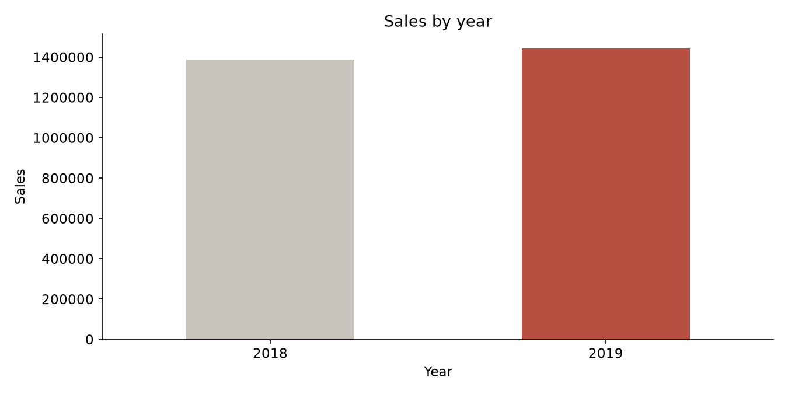

**Finding:** Sales totalled 2.83M from 909 orders (7,997 dishes). 2019 sales were 1.44M vs 1.39M in 2018 (+3.8%). Order count barely moved (452 to 457); growth came from a higher average order (3,073 to 3,157).

**Recommendation:** Growth is slow and comes from bigger orders, not more orders. Set a 2020 target for order count (for example +5%) and track orders and average order value as separate KPIs.

### Q2. Is there a reliable monthly seasonal pattern?

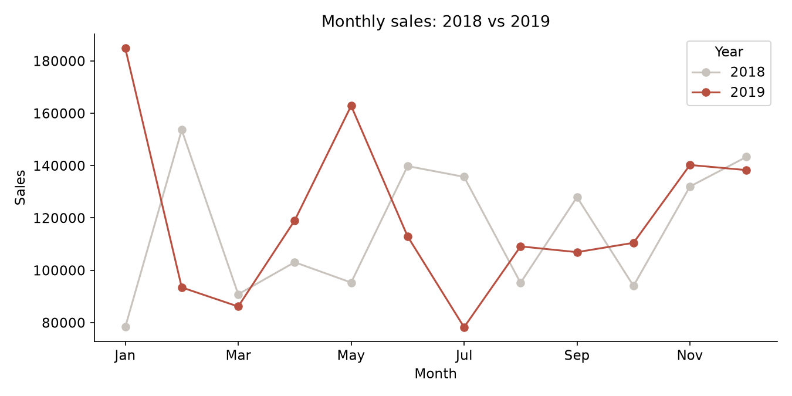

**Finding:** No. The original dashboard adds 2018 and 2019 together by month, which suggests a December peak (281.6K) and a March dip (177.0K). Split by year, the months do not repeat: January was 78.3K in 2018 but 184.9K in 2019, and the correlation between the two years' monthly patterns is -0.38. Nov and Dec are the only months above average in both years (275.3K in 2018, 278.5K in 2019).

**Recommendation:** Do not plan staffing or stock from a single 'seasonality' chart that merges years. Plan month by month from a rolling forecast, and only lock in a Nov-Dec uplift, the one pattern seen in both years.

### Q3. Which dishes drive revenue, and is that price or volume?

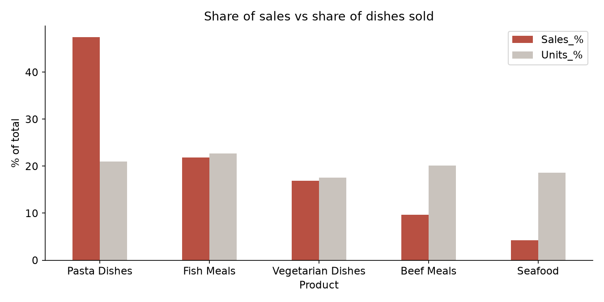

**Finding:** Pasta Dishes earn 47.4% of sales (1.34M) but only 21.0% of dishes sold. It is price-driven: a pasta dish sells at 799.95, vs 79.99 for Seafood. Seafood sells 18.6% of dishes but brings only 4.2% of sales.

**Recommendation:** Protect pasta availability and quality first; it is nearly half the business. Use Seafood as a low-price add-on or review its price, since its volume is not turning into revenue.

### Q4. Which dishes grew or shrank from 2018 to 2019?

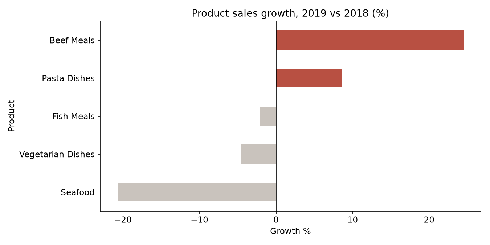

**Finding:** Beef Meals grew fastest (+24.5%) and Pasta Dishes grew +8.6%. Seafood fell 20.7%, Vegetarian 4.6% and Fish 2.1%.

**Recommendation:** Put promotion budget behind Beef and Pasta, which are already growing. Run a short review of the Seafood menu (price, portion, visibility) before cutting it.

### Q5. Which regions sell the most, and how did they change?

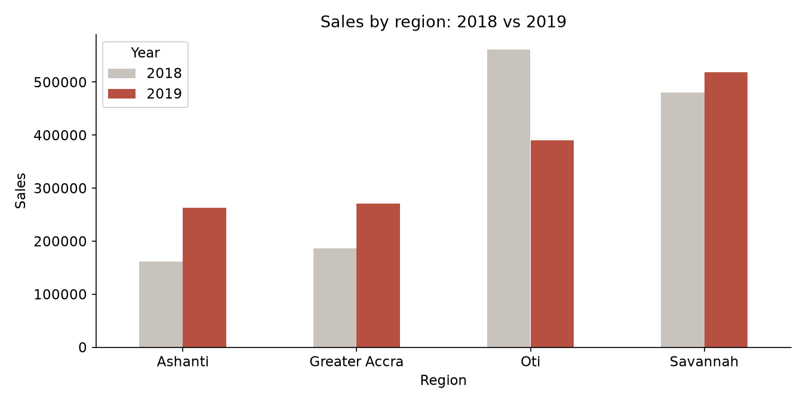

**Finding:** Savannah (35.3%) and Oti (33.6%) together make up 68.9% of sales. But Oti fell 30.5% in 2019 (561.2K to 389.9K), while Ashanti grew +62.7% and Greater Accra +45.4%.

**Recommendation:** Treat Oti as the priority region for 2020. The decline is concentrated in one area, so it can be fixed (see Q6). Keep investing in Ashanti and Greater Accra, where momentum is strong.

### Q6. What explains the Oti decline? Which salespeople grew or declined?

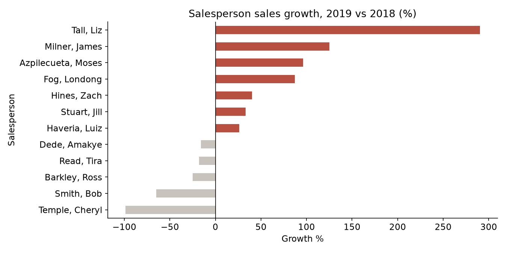

**Finding:** Two Oti reps account for the drop. Temple, Cheryl went from 180.3K to 2.0K (last sale 2019-01-18, only 5 orders in 2019). Smith, Bob fell 65.1% (last sale 2019-09-09). Other Oti reps recovered only part of the loss. Tall, Liz (+290.4%) and Milner, James (+124.9%) grew fastest.

**Recommendation:** When a rep leaves or goes quiet, reassign their customers within 30 days. Add a 'days since last sale' check per rep to the monthly dashboard so this shows up early.

### Q7. How dependent are we on a few customers?

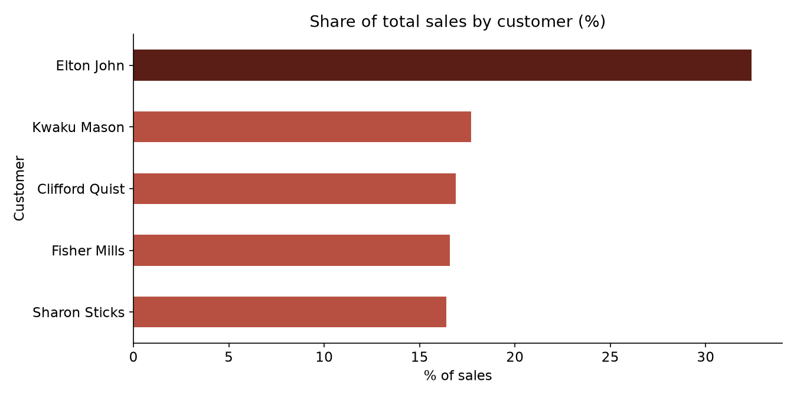

**Finding:** Elton John buys 32.4% of all sales (917.5K), almost twice the next customer. This customer's average order is 4,754 vs 2,673 for the other four, and 50.2% of their spend is pasta. Their spend was flat (-0.3%). Sharon Sticks grew most (+21.3%).

**Recommendation:** Give Elton John a named account manager and a retention offer, since losing them would cut about a third of sales. Cross-sell pasta to the other four customers to reduce the dependence.

### Q8. Who are the top salespeople, and what makes them top?

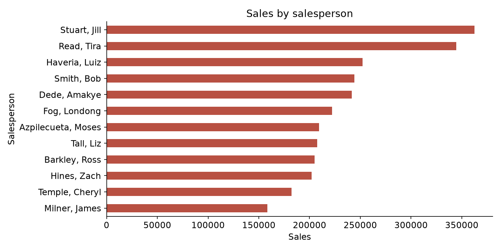

**Finding:** Stuart, Jill (362.4K) and Read, Tira (344.4K) lead with 25.0% of sales together. The top rep sells 2.29x the bottom rep (Milner, James, 158.5K). Rep sales track the number of orders (correlation 0.90), not order size (0.06).

**Recommendation:** Coach on activity, meaning more customer contacts and more orders, rather than on upselling. Pair low-order reps with Stuart, Jill for call planning.

### Q9. What size are typical orders, and where does the money come from?

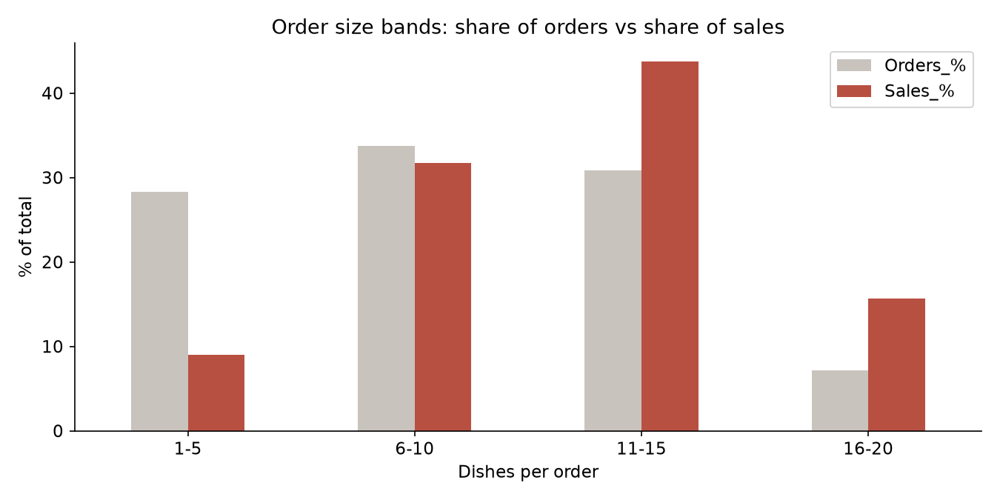

**Finding:** Orders range from 1 to 20 dishes (median order 2,045.70). Orders of 11+ dishes are 38.0% of orders but 59.3% of sales. Small orders (1-5 dishes) are 28.3% of orders and only 9.0% of sales.

**Recommendation:** Introduce a volume deal at 11+ dishes (for example, a free side) to move 6-10 dish orders up a band. Handle 1-5 dish orders through a low-cost channel.

### Q10. Which days of the week do orders come in?

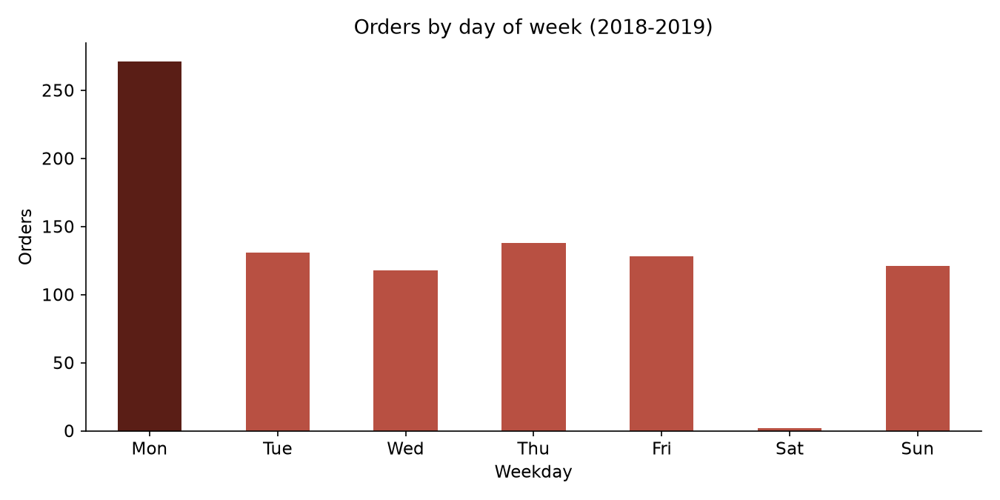

**Finding:** Monday is the busiest day by far: 271 orders (29.8%) and 28.0% of sales. The other weekdays and Sunday get 118-138 orders each. Saturday has only 2 orders in two years, so the business is effectively closed on Saturdays.

**Recommendation:** Staff and prep for Monday as the peak day. Consider a Saturday offer or confirm the closure. Check whether Monday orders are weekend demand booked late, and smooth it with pre-orders.

## Priority actions

1. Reassign inactive reps' customers within 30 days and track 'days since last sale' (Q6)
2. Make Oti the 2020 priority region (Q5)
3. Key-account plan for Elton John; cross-sell pasta to the other four customers (Q7)
4. Volume deal at 11+ dishes to lift 6-10 dish orders (Q9)
5. Plan from a rolling forecast, not a merged-year seasonality chart; staff for Mondays (Q2, Q10)

## Deliverables

| File | What it is |
|---|---|
| [`analysis/Project1_RestaurantSales_Analysis_final.xlsx`](analysis/Project1_RestaurantSales_Analysis_final.xlsx) | Analysis workbook: Dashboard, About, Validation (issue log and reconciliation), CleanData table, and one sheet per question with a formula table, chart, finding and recommendation. Every number is a live SUMIFS/COUNTIFS formula. |
| [`notebooks/Project1_RestaurantSales_Analysis_final.ipynb`](notebooks/Project1_RestaurantSales_Analysis_final.ipynb) | Beginner-friendly pandas notebook: validation, cleaning and all 10 questions. It writes the clean CSV and the charts. |
| [`presentation/Project1_RestaurantSales_Deck_final.pptx`](presentation/Project1_RestaurantSales_Deck_final.pptx) | 14-slide stakeholder deck with native, editable charts and speaker notes. |
| [`data/processed/Project1_sales_clean_final.csv`](data/processed/Project1_sales_clean_final.csv) | Cleaned data (909 rows, 14 columns). |
| [`data/raw/Project1_PivotTables_Sales.xlsx`](data/raw/Project1_PivotTables_Sales.xlsx) | Original workbook, unchanged. |
| `images/` | Notebook charts, Excel dashboard and validation screenshots, and the original dashboard (`original_excel_dashboard.jpg`). |

## How to reproduce

```bash
git clone <this-repo-url>
cd Project1_PivotTables_Sales
pip install -r requirements.txt
```

Run the notebook from the `notebooks/` folder so the relative paths work:

```bash
cd notebooks
jupyter nbconvert --to notebook --execute --inplace Project1_RestaurantSales_Analysis_final.ipynb
```

This re-creates `data/processed/` and the PNG charts in `images/`. Open the Excel workbook in Excel 2019 or Microsoft 365 (it uses MINIFS/MAXIFS). Formulas recalculate on open.

## Folder structure

```
Project1_PivotTables_Sales/
├── README.md
├── requirements.txt
├── .gitignore
├── data/
│   ├── raw/Project1_PivotTables_Sales.xlsx        # original, untouched
│   └── processed/Project1_sales_clean_final.csv
├── analysis/
│   └── Project1_RestaurantSales_Analysis_final.xlsx
├── notebooks/
│   └── Project1_RestaurantSales_Analysis_final.ipynb
├── images/                 # charts + dashboard screenshots
└── presentation/
    └── Project1_RestaurantSales_Deck_final.pptx
```

The original `Project1_PivotTables_Sales.xlsx` and `dashboard_1.jpg` are also still in the project root, as they were before this reorganisation.

## Tools

Microsoft Excel (pivot tables, slicers, SUMIFS/COUNTIFS, charts) · Python (pandas, matplotlib) · Jupyter · PowerPoint

## Limitations

- No cost, margin or discount data, so profitability is out of scope.
- Only 5 customers and 12 reps, so the shares and correlations are descriptive, not statistically tested.
- Two years of data are too few to model seasonality; Q2 shows the two years disagree.
