# Excel Class Restaurant: 2020 Sales Dashboard Analysis

**Excel pivot tables + Python | Sales dashboard review**

A restaurant's 2020 sales log of **909 transactions**: 12 salespeople, 5 product categories, 4 regions (North, East, South, West) and 5 customers. The original Excel project is a one-page pivot dashboard with KPI cards, a region slicer and a timeline. This repository checks that the dashboard reconciles, then goes further: rep productivity, product mix, customer risk and regional momentum.

> **Data note:** these are the same 909 transactions as Project 1 (2018-2019), with the regions renamed (Oti to East, Savannah to North, Greater Accra to South, Ashanti to West) and every date moved into 2020, keeping its month and day. All findings below are true for this file as given. Weekday patterns are not real here, so they are not analysed.

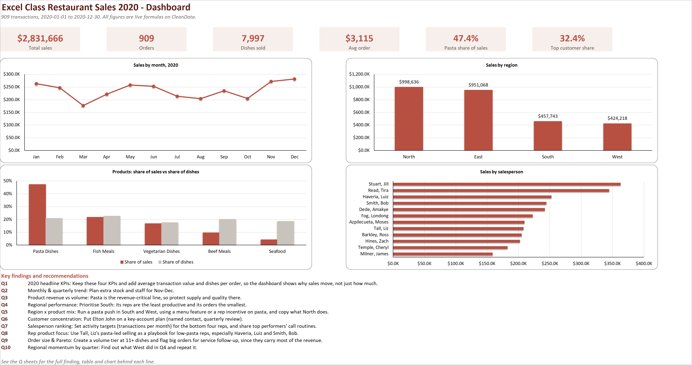

## Headline numbers

| Metric | Value |
|---|---|
| Total sales | $2,831,665.67 |
| Transactions | 909 |
| Dishes sold | 7,997 |
| Average transaction | $3,115.14 |
| Customers / products / salespeople / regions | 5 / 5 / 12 / 4 |

Currency: USD, as labelled in the source workbook.

## Business questions

| # | Question |
|---|---|
| Q1 | What did the restaurant sell in 2020, and do the dashboard KPIs reconcile with the raw data? |
| Q2 | How did sales move through the year? Which months and quarters were strongest? |
| Q3 | Which products drive sales, and is that price or volume? |
| Q4 | Which regions perform best, and is that from more reps or better reps? |
| Q5 | Does the product mix differ by region? |
| Q6 | How dependent are we on our biggest customer? |
| Q7 | Which salespeople perform best, and what drives the gap? |
| Q8 | Do salespeople sell a different product mix? |
| Q9 | How are sales spread across transaction sizes? |
| Q10 | Which regions gained or lost momentum during the year? |

The data has **no cost, profit or discount fields**, so margin and discount questions cannot be answered. The analysis covers revenue, volume (dishes), mix and concentration.

## Process

1. **Inspect** the original workbook: sheets, pivot tables, pivot cache, charts, slicers, formulas and named ranges.
2. **Validate** the raw table: blanks, duplicates, date validity, value range and category labels.
3. **Clean**: trim labels, round sales to cents, add date parts, and derive unit price and dishes per order.
4. **Reconcile** every original pivot total against the cleaned data.
5. **Analyse** each business question in Excel (live formulas) and in Python (notebook).
6. **Communicate**: dashboard, stakeholder deck, and this README.

## Data validation and cleaning

| Check | Result |
|---|---|
| Rows | 909 |
| Blank cells | 0 |
| Exact duplicate rows | 0 |
| Invalid dates | 0 (range 2020-01-01 to 2020-12-30) |
| Zero or negative sales | 0 |
| Product labels with a trailing space | **370 rows** ('Fish Meals ', 'Vegetarian Dishes '): trimmed |
| Floating-point noise (e.g. 3068.5499999) | rounded to 2 decimals |
| Sales are whole multiples of one unit price | yes: 1 to 20 dishes per order, so a Units column was derived |
| Salesperson in two regions | Azpilecueta, Moses |

**Unit prices derived from the data:** Beef Meals $168.95, Fish Meals $340.95, Pasta Dishes $799.95, Seafood $79.99, Vegetarian Dishes $340.95.

**Issues found in the original workbook:**

- The workbook has an **external link** to a lookup-functions file on another computer, which can trigger an update-links prompt when the file is opened.
- Broken named ranges: `Exchange_rate` and `Figures` = #REF!, and `Grading_Scheme` points to the external file. There are also 30 hidden `IQ_*` names left over from a template.
- An empty, very hidden sheet (`Sheet9`).
- None of these affect the numbers: all four KPI cards and all pivot totals reconcile exactly with the raw data.

The analysis workbook's **Validation** sheet repeats these checks and reconciles **48 original pivot values** against the cleaned data. All 48 match.

## Findings and recommendations

### Q1. What did the restaurant sell in 2020, and do the dashboard KPIs reconcile with the raw data?

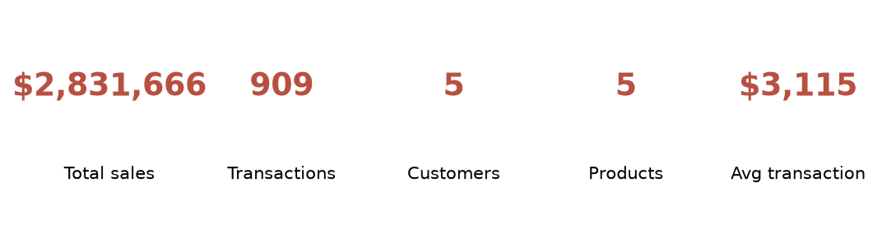

**Finding:** Sales were $2.83M ($2,831,666) from 909 transactions, 7,997 dishes, 5 customers and 5 products, an average of $3,115 per transaction. All four dashboard KPI cards and all five pivot totals match the raw data exactly.

**Recommendation:** Keep these four KPIs and add average transaction value and dishes per order, so the dashboard shows why sales move, not just how much.

### Q2. How did sales move through the year? Which months and quarters were strongest?

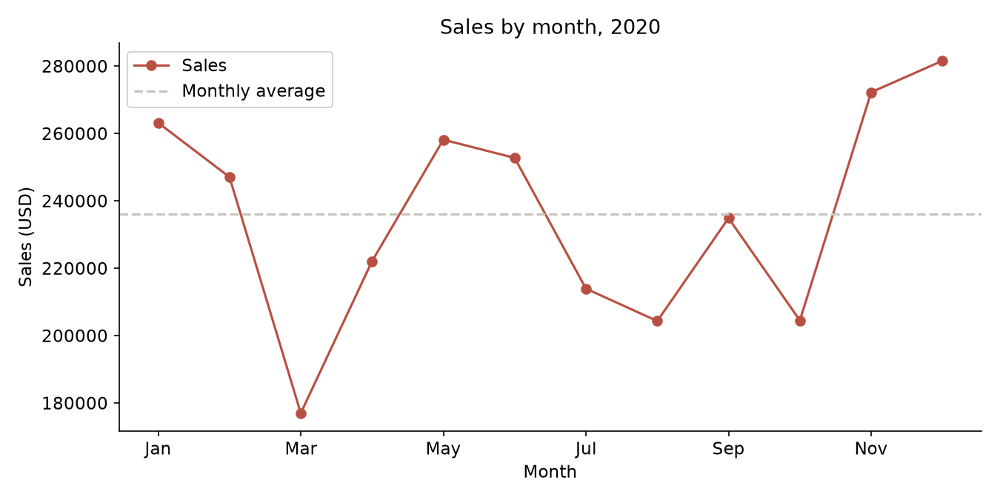

**Finding:** December was the best month ($281.6K) and March the weakest ($177.0K). Q4 was the strongest quarter ($758.3K, 26.8%) and Q3 the weakest ($653.1K). Nov-Dec alone brought 19.6% of annual sales.

**Recommendation:** Plan extra stock and staff for Nov-Dec. Run a March and Q3 promotion to lift the two soft spots.

### Q3. Which products drive sales, and is that price or volume?

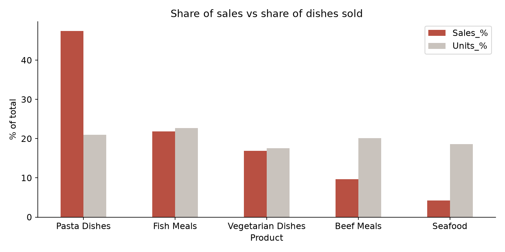

**Finding:** Pasta Dishes earn 47.4% of sales ($1.34M) from just 21.0% of dishes, at $799.95 each. Seafood sells 18.6% of dishes at $79.99 and brings only 4.2% of sales.

**Recommendation:** Pasta is the revenue-critical line, so protect supply and quality there. Test a Seafood price increase or bundle Seafood with pasta.

### Q4. Which regions perform best, and is that from more reps or better reps?

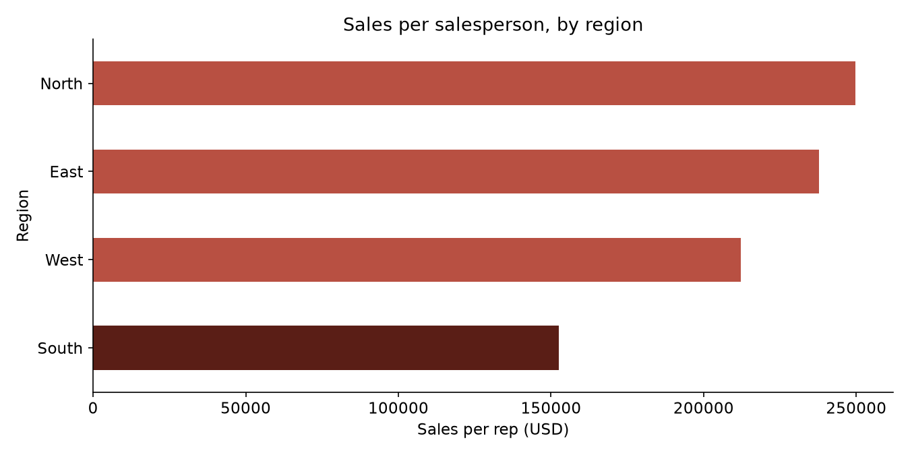

**Finding:** North (35.3%) and East (33.6%) bring 68.9% of sales. Per rep, North makes $249.7K and South only $152.6K. South also has the smallest average transaction ($2,601 vs $3,432 in North).

**Recommendation:** Prioritise South: its reps are the least productive and its orders the smallest. Review its customer mix and coach on bigger baskets before adding headcount anywhere.

### Q5. Does the product mix differ by region?

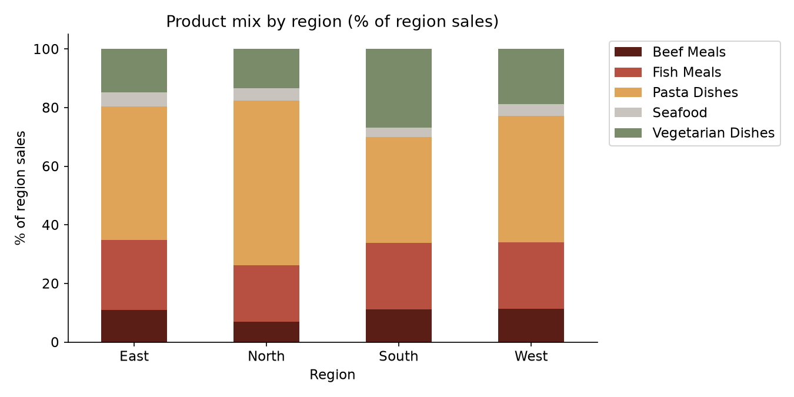

**Finding:** Yes. Pasta is 56.1% of North's sales but only 36.2% of South's. North, with the highest pasta share, also has the largest average transaction; South is lowest on both.

**Recommendation:** Run a pasta push in South and West, using a menu feature or a rep incentive on pasta, and copy what North does.

### Q6. How dependent are we on our biggest customer?

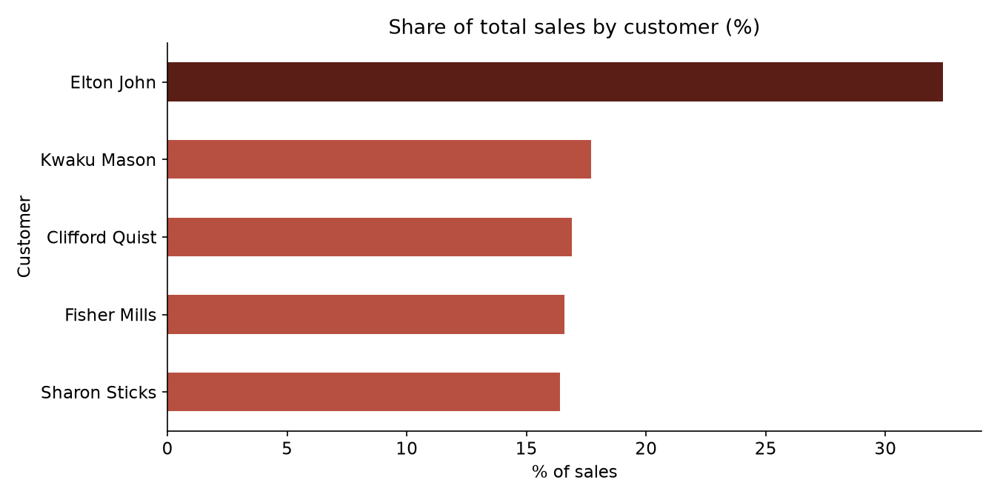

**Finding:** Elton John accounts for 32.4% of sales ($917.5K), almost twice the next customer ($501.1K). Their average transaction is $4,754 vs $2,673 for the rest, and 50.2% of their spend is pasta.

**Recommendation:** Put Elton John on a key-account plan (named contact, quarterly review). Grow the other four customers' pasta orders to reduce the risk.

### Q7. Which salespeople perform best, and what drives the gap?

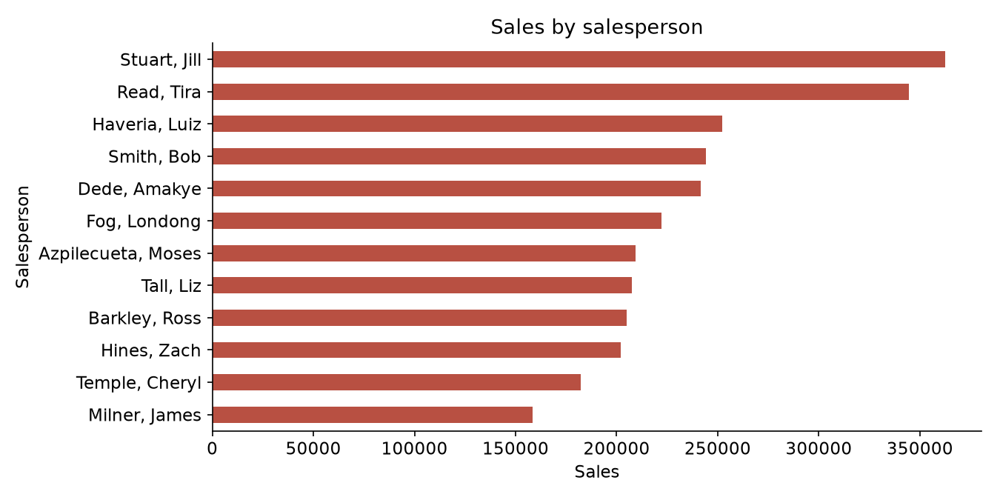

**Finding:** Stuart, Jill ($362.4K) and Read, Tira ($344.4K) lead with 25.0% of sales together. Milner, James is last ($158.5K); the top rep sells 2.29x the bottom. Sales track transaction count (correlation 0.90), not transaction size (0.06).

**Recommendation:** Set activity targets (transactions per month) for the bottom four reps, and share top performers' call routines.

### Q8. Do salespeople sell a different product mix?

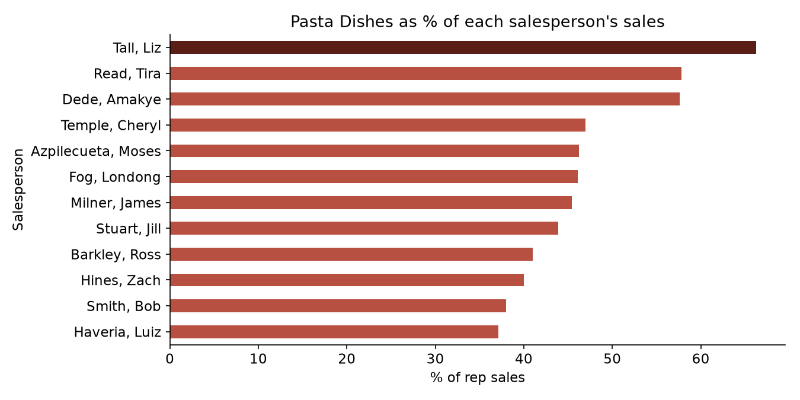

**Finding:** Pasta share ranges from 66.2% of sales (Tall, Liz) down to 37.1% (Haveria, Luiz). Tall, Liz has the highest average transaction ($3,994) despite having the fewest transactions (52).

**Recommendation:** Use Tall, Liz's pasta-led selling as a playbook for low-pasta reps, especially Haveria, Luiz and Smith, Bob.

### Q9. How are sales spread across transaction sizes?

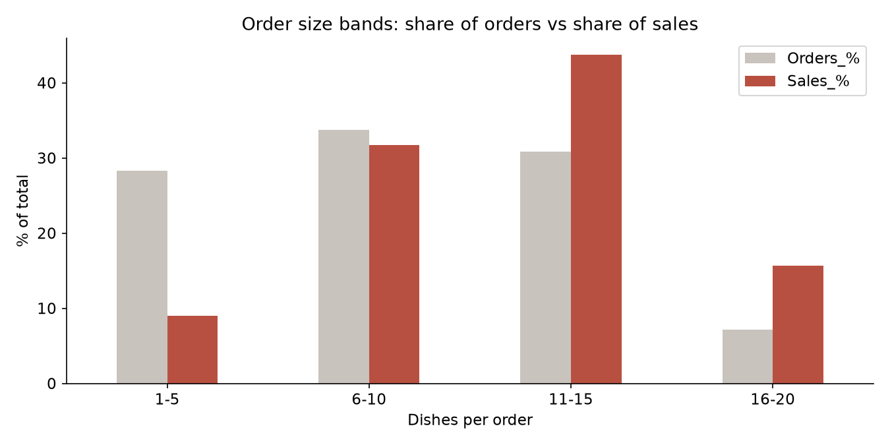

**Finding:** The top 20% of transactions (182) bring 52.6% of sales. Transactions of 11+ dishes are 38.0% of the count but 59.3% of sales. The median transaction is $2,045.70; the largest is $15,999.00.

**Recommendation:** Create a volume tier at 11+ dishes and flag big orders for service follow-up, since they carry most of the revenue.

### Q10. Which regions gained or lost momentum during the year?

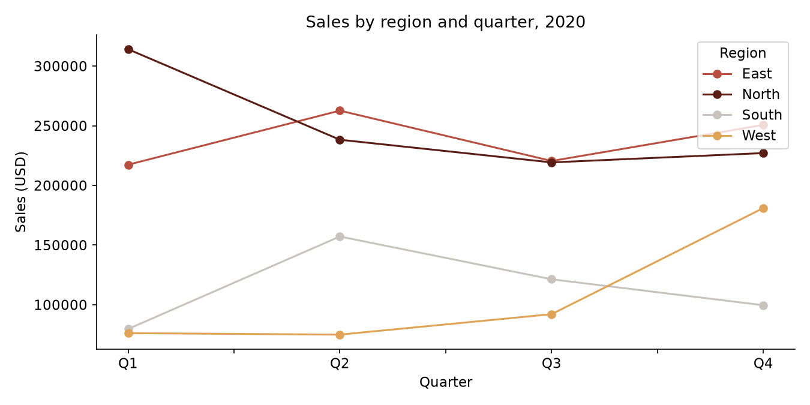

**Finding:** West nearly doubled from Q3 to Q4 ($92.1K to $181.0K). North fell from $314.1K in Q1 to $227.1K in Q4, so the top region is losing ground.

**Recommendation:** Find out what West did in Q4 and repeat it. Review North's Q2-Q4 slowdown with its four reps before it loses the top spot.

## Priority actions

1. Pasta push in South and West, using Tall, Liz's playbook (Q5, Q8)
2. Coach South on bigger baskets before adding headcount (Q4)
3. Key-account plan for Elton John (Q6)
4. Volume tier at 11+ dishes; follow up on big orders (Q9)
5. Stock and staff up for Nov-Dec; promotions for March and Q3 (Q2)

## Deliverables

| File | What it is |
|---|---|
| [`analysis/Project2_RestaurantSales2020_Analysis_final.xlsx`](analysis/Project2_RestaurantSales2020_Analysis_final.xlsx) | Analysis workbook: Dashboard, About, Validation (issue log and reconciliation), CleanData table, and one sheet per question with a formula table, chart, finding and recommendation. Every number is a live SUMIFS/COUNTIFS formula. |
| [`notebooks/Project2_RestaurantSales2020_Analysis_final.ipynb`](notebooks/Project2_RestaurantSales2020_Analysis_final.ipynb) | Beginner-friendly pandas notebook: validation, cleaning and all 10 questions. It writes the clean CSV and the charts. |
| [`presentation/Project2_RestaurantSales2020_Deck_final.pptx`](presentation/Project2_RestaurantSales2020_Deck_final.pptx) | 14-slide stakeholder deck with native, editable charts and speaker notes. |
| [`data/processed/Project2_sales_clean_final.csv`](data/processed/Project2_sales_clean_final.csv) | Cleaned data (909 rows, 14 columns). |
| [`data/raw/Project2_PivotTables_Sales.xlsx`](data/raw/Project2_PivotTables_Sales.xlsx) | Original workbook, unchanged. |
| `images/` | Notebook charts, Excel dashboard and validation screenshots, and the original dashboard (`original_excel_dashboard.jpg`). |

## How to reproduce

```bash
git clone <this-repo-url>
cd Project2_PivotTables_Sales
pip install -r requirements.txt
```

Run the notebook from the `notebooks/` folder so the relative paths work:

```bash
cd notebooks
jupyter nbconvert --to notebook --execute --inplace Project2_RestaurantSales2020_Analysis_final.ipynb
```

This re-creates `data/processed/` and the PNG charts in `images/`. Open the Excel workbook in Excel 2019 or Microsoft 365 (it uses MINIFS/MAXIFS). Formulas recalculate on open.

## Folder structure

```
Project2_PivotTables_Sales/
├── README.md
├── requirements.txt
├── .gitignore
├── data/
│   ├── raw/Project2_PivotTables_Sales.xlsx        # original, untouched
│   └── processed/Project2_sales_clean_final.csv
├── analysis/
│   └── Project2_RestaurantSales2020_Analysis_final.xlsx
├── notebooks/
│   └── Project2_RestaurantSales2020_Analysis_final.ipynb
├── images/                 # charts + dashboard screenshots
└── presentation/
    └── Project2_RestaurantSales2020_Deck_final.pptx
```

The original `Project2_PivotTables_Sales.xlsx` and `dashboard_1.jpg` are also still in the project root, as they were before this reorganisation.

## Tools

Microsoft Excel (pivot tables, slicers, SUMIFS/COUNTIFS, charts) · Python (pandas, matplotlib) · Jupyter · PowerPoint

## Limitations

- No cost, margin or discount data, so profitability is out of scope.
- Only 5 customers and 12 reps, so the shares and correlations are descriptive, not statistically tested.
- The 2020 dates are re-stamped from 2018-2019 (see the data note), so day-of-week and day-level timing are not meaningful.
