# Project 3 – Depot Loading Turnaround Time (TAT) Analysis

**Source file:** `data/Project3_EmployeeTurnAround.xlsx` (only read by the analysis)
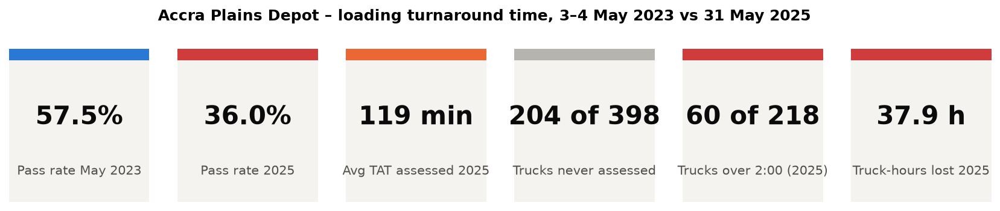

**Tools:** Python (pandas, matplotlib) in Jupyter · Excel (formulas, tables, charts)

## Repo structure
```
Project3_EmployeeTurnAround/
├── README.md
├── data/
│   ├── Project3_EmployeeTurnAround.xlsx           # source workbook (3 daily sheets; external link removed)
│   ├── loading_log_raw.csv                         # all 3 sheets as recorded (398 rows)
│   └── Project3_LoadingTAT_CleanData_final.csv     # cleaned data (398 rows)
├── excel/
│   └── Project3_LoadingTAT_Analysis_final.xlsx     # dashboard, BP1–BP10 sheets, validation, CleanData
├── notebooks/
│   └── Project3_LoadingTAT_Analysis_final.ipynb    # pandas validation, cleaning and analysis
├── images/                                         # 16 notebook charts, 7 Excel screenshots, 4 original dashboard screenshots
├── presentation/
│   └── Project3_LoadingTAT_Presentation_final.pptx # 15-slide project deck with speaker notes
└── docs/
    └── data_cleaning_notes.md                      # every check, fix and reconciliation
```

**Presentation:** [`presentation/Project3_LoadingTAT_Presentation_final.pptx`](presentation/Project3_LoadingTAT_Presentation_final.pptx) is a 15-slide deck with speaker notes. It covers what the data is, the 10 business questions, how the project was done, the validation results, the findings and the recommendations.

## 1. What the workbook actually contains
The file name suggests employee turnover, but the workbook is a **fuel-depot truck loading log** for **Accra Plains Depot**.
"TurnAround" means the **turnaround time (TAT)** of tanker trucks (BRVs, Bulk Road Vehicles) from gate-in to gate-out.

| Sheet | Contents |
|---|---|
| `31.05.2025` | 218 trucks loaded on 31 May 2025 |
| `03.05.2023` | 90 trucks loaded on 3 May 2023 |
| `04.05.2023` | 90 trucks loaded on 4 May 2023 (rows identical to 3 May, see below) |

Each sheet has the same layout:
* **Data table (A–M):** ITEM, BOST/OMC, BRV #, BDC, TRANSPORTER, PRODUCT (AGO = diesel, PMS = petrol), CAPACITY, TIME IN, TIME OUT.
  The formula columns are TAT (`=TIME OUT − TIME IN`), REMARKS and MEAS (a 15-minute band), plus a CR (Challenge Register) drop-down.
* **Rules:** expected TAT is **1:45** (cell D3) and the reference capacity is **45,000 L** (cell H3).
  A truck of 45,000 L or more is *Passed* if TAT ≤ 1:45 and *Failed* otherwise. Smaller trucks get *No Remarks*.
* **Built-in analysis (O–AB):**
  * Analysis 1: Passed/Failed counts, average TAT, best and worst time, with a 3-D pie.
  * Analysis 2: count per 15-minute band, with a column chart.
  * Analysis 3: count per Challenge Register delay code, with a bar chart.
  The four `dashboard_*.jpg` files are screenshots of these.
* **Purpose:** a daily management view of how many trucks meet the 1:45 standard, how late the late ones are, and why.

## 2. Business problems
1. Overall TAT compliance (pass rate), May 2023 vs May 2025
2. KPI coverage: trucks never assessed
3. How late are late trucks (15-minute bands, minutes over target)
4. Product: diesel (AGO) vs petrol (PMS)
5. Customer channel: BOST vs OMC
6. BDC (product owner) performance
7. Hauliers and OMC customers: repeat late trucks
8. Time of arrival and congestion
9. Root causes: the Challenge Register
10. Cost of delay (truck-hours above target)

## 3. Validation and cleaning
**Process:** read both report sheets → compare category counts with the workbook's own summary tables → recompute every formula column from the raw times → fix the problems found → reconcile.

Key issues: the 04 May 2023 log repeats the 03 May log row for row (kept as its own day and flagged), 9 rows in the wrong 15-minute band, 1 failed truck with no delay code, delay codes that follow the product rather than the cause, a TRANSPORTER column with two meanings, and many name variants. The full check list is in [`docs/data_cleaning_notes.md`](docs/data_cleaning_notes.md).

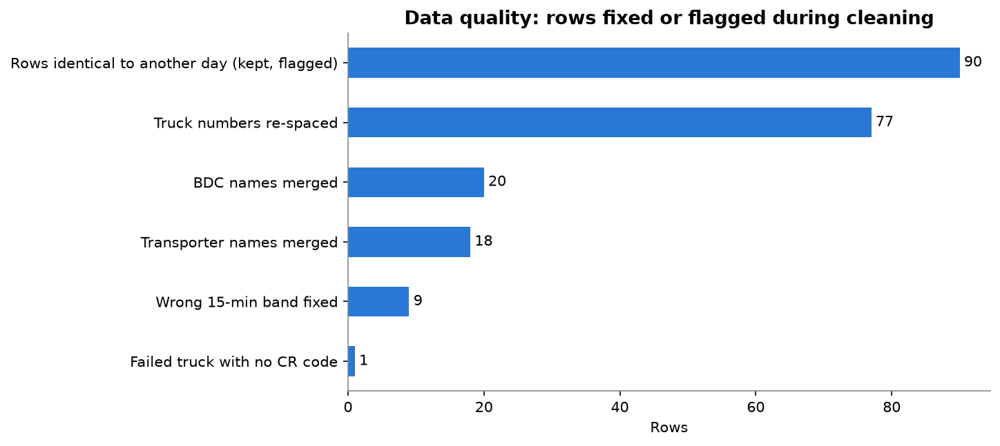

**Reconciliation:** the Excel `Validation` sheet compares 20 figures from the original summary tables (all three sheets) with formulas on `CleanData`. **All 20 show OK.**

## 4. Findings and recommendations

### BP1 – Overall TAT compliance
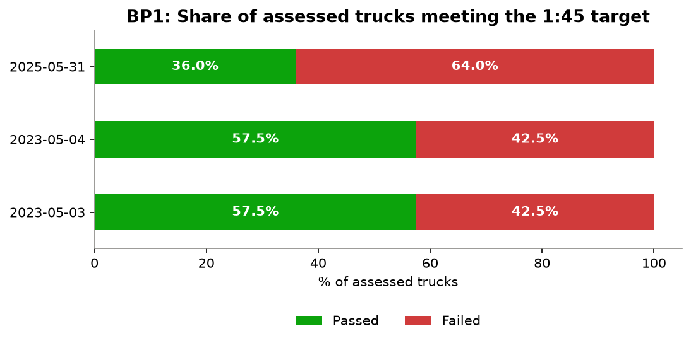
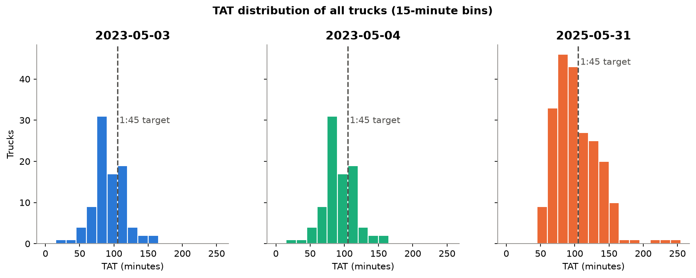

**Finding:** Only **36.0%** of assessed trucks (41 of 114) met the 1:45 target on 31 May 2025, against **57.5%** (23 of 40) on each of 3 and 4 May 2023. The average TAT of assessed trucks rose from 101.8 minutes on each 2023 day to 119.2 minutes in 2025 (1:42 to 1:59). Across all trucks it rose from 92.5 to 102.2 minutes. The 2025 day also handled 2.4 times as many trucks as a 2023 day (218 against 90). There are only three days, and the two 2023 logs are identical, so treat this as a signal, not a proven trend.

**Recommendation:** Track the pass rate every day, with a rolling 2-week trend, instead of one-off daily sheets. Collect at least a month of daily logs before setting improvement targets.

### BP2 – KPI coverage
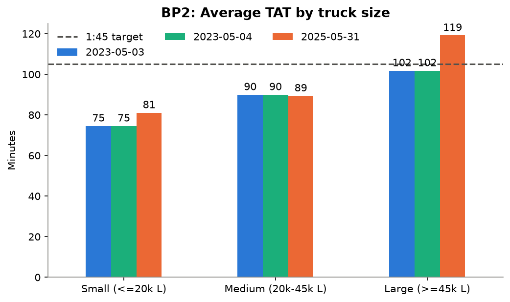
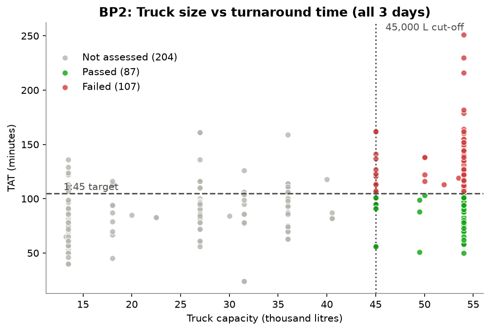

**Finding:** Just over half of all trucks (**204 of 398**) are labelled "No Remarks" because they hold under 45,000 L, so they are never measured. They are not quick to load: small trucks (20,000 L or less) average 75 minutes on site on each 2023 day and 81 minutes in 2025. They load at about 182 to 198 L/min, against 482 to 528 L/min for large trucks. Per litre loaded, they hold a bay about 2.7 times as long.

**Recommendation:** Give smaller trucks their own target scaled to size (for example, a target in L/min), so every truck is measured. Report KPI coverage (% of trucks assessed) next to the pass rate.

### BP3 – How late are late trucks
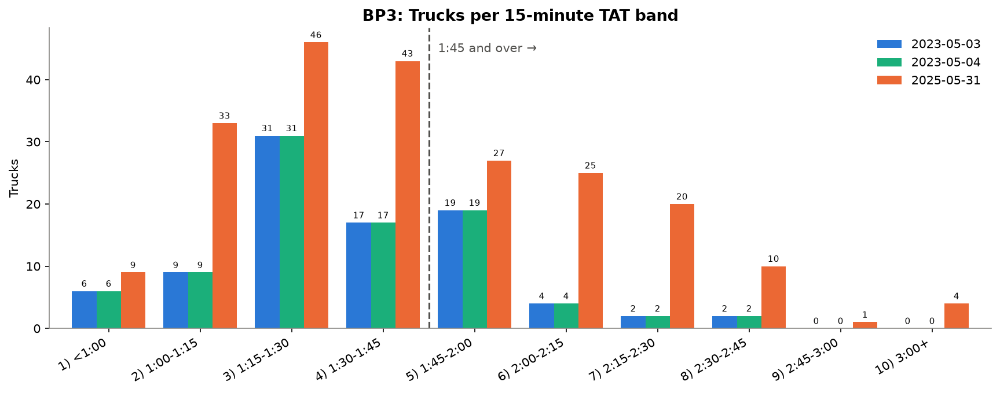

**Finding:** In 2025, **60 of 218 trucks (27.5%)** took longer than 2 hours, against 8 of 90 (8.9%) on each 2023 day. Failed trucks averaged **31.1 minutes over target** in 2025 (worst case 146 minutes over, a 4:11 TAT), against 16.1 minutes on each 2023 day (worst 57 minutes over). Most trucks land in the 1:15 to 1:45 bands, but 2025 has a long tail past 2:00.

**Recommendation:** Escalate any truck still on site at 2:00 to the shift supervisor so the long tail gets attention. Measure the tail (% of trucks over 2:00) as a second KPI.

### BP4 – Product: AGO vs PMS
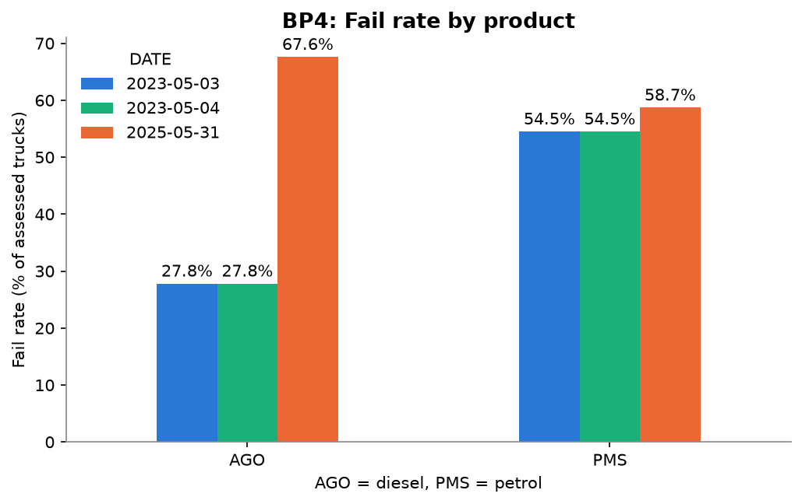

**Finding:** Diesel (AGO) got much worse. Its fail rate went from **27.8%** (5 of 18 on each 2023 day) to **67.6%** (46 of 68) in 2025. Petrol (PMS) went from 54.5% (12 of 22 each day) to 58.7% (27 of 46). In 2025, 68 of the 114 assessed trucks were diesel, which is where the volume and the failures grew.

**Recommendation:** Report the pass rate separately for each product gantry. Review diesel gantry capacity (bays, meters and dipping) against the larger 2025 diesel volume.

### BP5 – Customer channel: BOST vs OMC
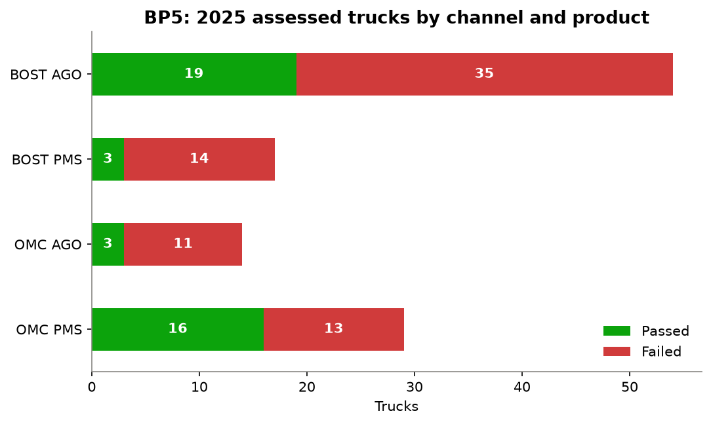

**Finding:** In 2025, BOST loads were 71 of 114 assessed trucks, against 3 of 40 on each 2023 day. BOST petrol was the worst group: **82.4% failed** (14 of 17), averaging 141 minutes. OMC diesel failed 78.6% (11 of 14) and BOST diesel 64.8% (35 of 54). OMC petrol did best, with 44.8% failed (13 of 29).

**Recommendation:** Agree loading windows (appointment slots) with BOST, so their bulk programme is spread across the day instead of arriving as one wave. Plan BOST petrol loads around single-arm capacity.

### BP6 – BDC performance
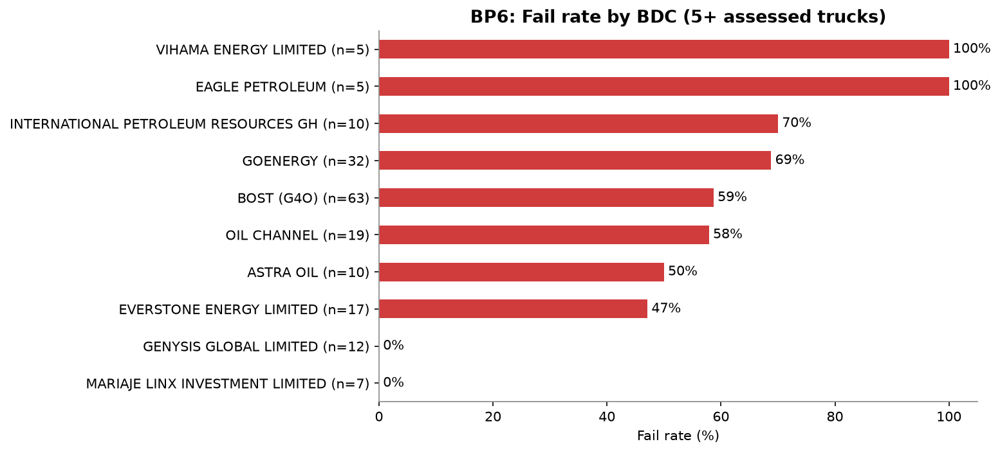

**Finding:** Among BDCs with at least 5 assessed trucks over the three days, **Eagle Petroleum and Vihama Energy failed 5 of 5 each**, averaging 165 and 160 minutes. All 10 were BOST petrol loads in 2025. International Petroleum Resources failed 7 of 10 (70%). The largest BDC, BOST (G4O), failed 37 of 63 (58.7%). Genysis Global (12 trucks) and Mariaje Linx (7 trucks) had no failures.

**Recommendation:** Send each BDC a monthly scorecard with pass rate and average TAT. Review product-release and paperwork steps for the worst BDCs, and compare them with Genysis and Mariaje Linx loads, which ran smoothly.

### BP7 – Hauliers and OMC customers
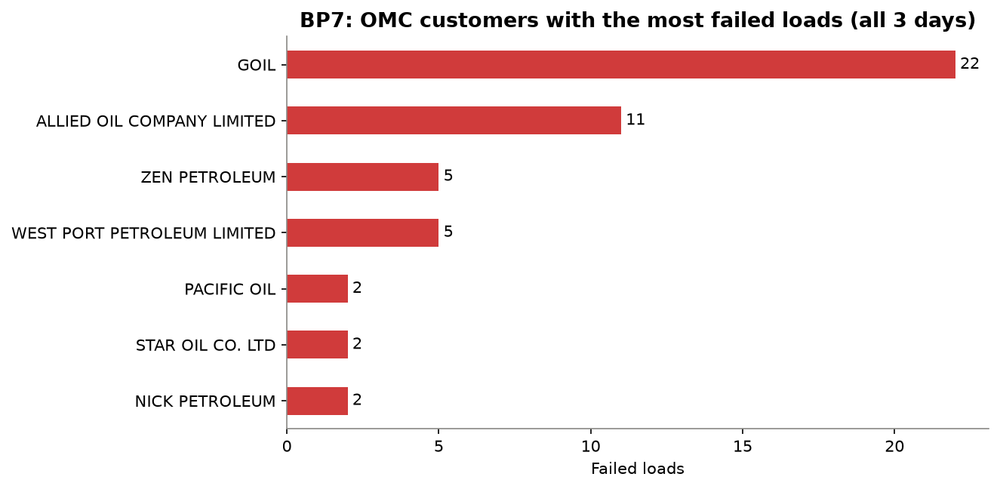

**Finding:** No BOST haulier failed more than twice: 7 hauliers had 2 failures each. Lateness is spread across many hauliers, which points to depot-side delays rather than bad driver behaviour. On the OMC side, **GOIL had 22 failed loads** (11 of 16 on each 2023 day), Allied Oil 11, and West Port Petroleum 5 (all 5 of its assessed trucks in 2025).

**Recommendation:** Focus improvement on depot processes, not on penalising hauliers. Review GOIL's and West Port's loading programmes (order timing and documents) with them.

### BP8 – Time of arrival and congestion
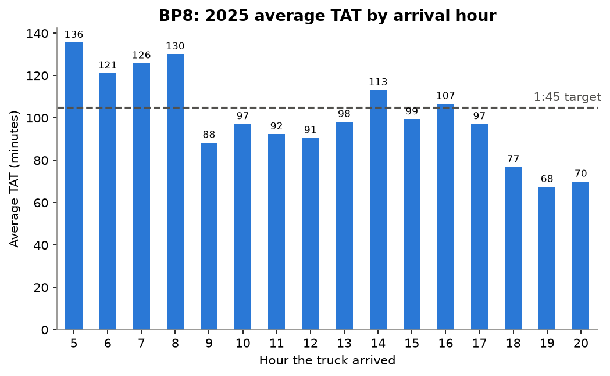
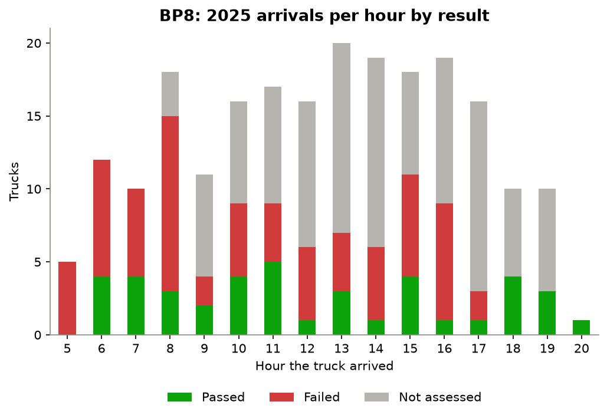

**Finding:** On 31 May 2025, trucks arriving between 05:00 and 08:59 averaged **127 minutes** (45 trucks, 41 of them BOST), against 96 minutes for later arrivals and 72 minutes after 18:00. The assessed fail rate was **73.8%** for trucks that arrived before 09:00 (42 trucks), against 58.3% from 09:00 (72 trucks).

**Recommendation:** Spread arrivals: stagger the BOST morning wave, open more bays and staff the documentation desk fully from 05:00, and move flexible OMC loads into the quieter evening window.

### BP9 – Root causes: the Challenge Register
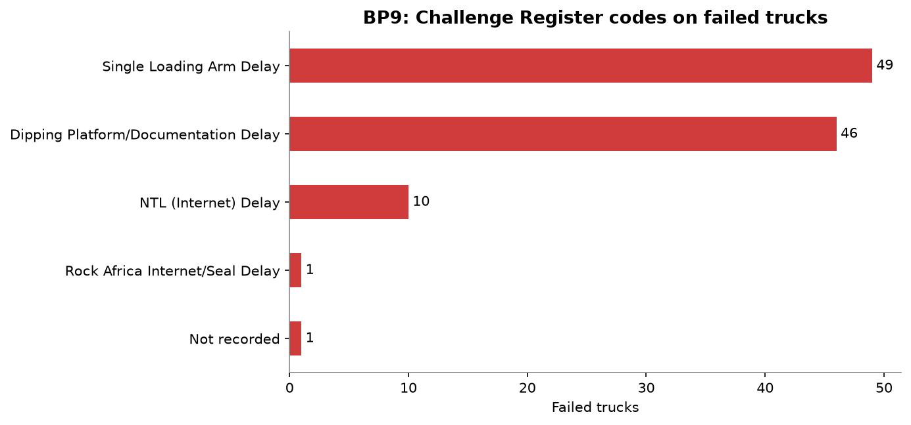
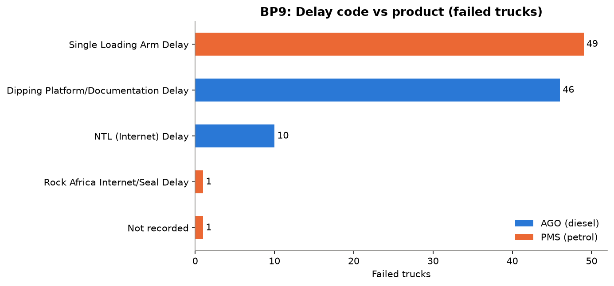

**Finding:** Two codes explain almost all 107 failures. **Single Loading Arm Delay** covers 49 (45.8%), and every one is a petrol truck. **Dipping Platform/Documentation Delay** covers 46 (43.0%), and every one is a 2025 diesel truck. The remaining codes are NTL internet delay (10, all 2023 diesel), Rock Africa internet/seal delay (1) and one truck not recorded. Because the code follows the product exactly, it is probably assigned per product line rather than investigated per truck.

**Recommendation:** Treat these as two bottleneck projects: add or restore a second petrol loading arm, and time-study the dipping platform and documentation steps for diesel. Fix the register itself: make the CR mandatory for every failed truck (data validation) and record time stamps per stage (gate in, start of loading, end of loading, documents, gate out) so each cause is backed by evidence.

### BP10 – Cost of delay
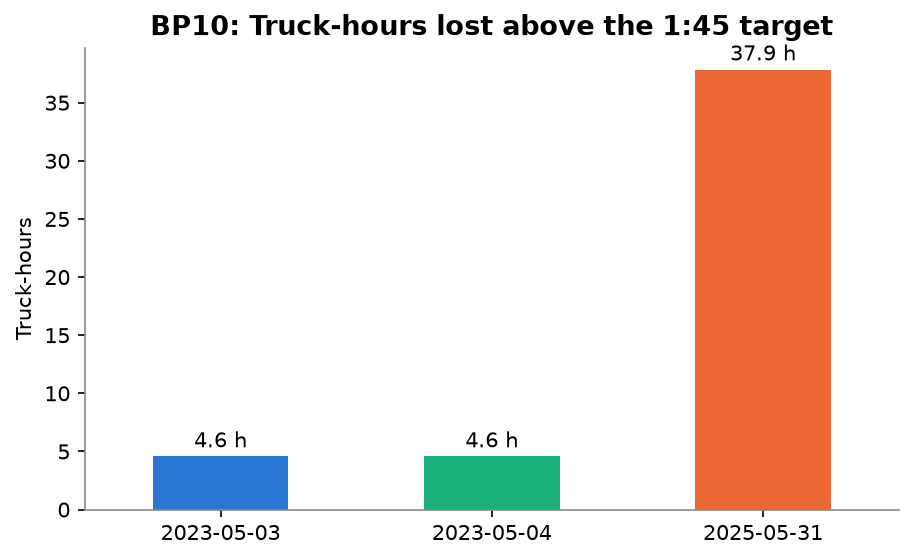

**Finding:** On 31 May 2025, the 73 failed trucks spent **2,271 minutes (37.9 truck-hours)** beyond the 1:45 target. That time could have covered about **21.6 extra loads** at the standard TAT. On each 2023 day, the figure was 274 minutes (4.6 truck-hours).

**Recommendation:** Put a money value on this using the depot's cost per truck-hour or demurrage rate, which is not in the data. Halving the excess time would free about 19 truck-hours on a day like 31 May 2025.

## 5. Summary
| # | Business problem | Key number |
|---|---|---|
| 1 | TAT compliance | Pass rate 57.5% (each 2023 day) → **36.0%** (2025) |
| 2 | KPI coverage | **204 of 398** trucks never assessed |
| 3 | Long tail | **60 of 218** trucks over 2:00 in 2025 |
| 4 | Product | Diesel fail rate 27.8% → **67.6%** |
| 5 | Channel | BOST petrol **82.4%** failed (2025) |
| 6 | BDC | Eagle Petroleum and Vihama Energy **5 of 5** failed |
| 7 | Hauliers | No haulier failed more than twice, so the delays are depot-side |
| 8 | Arrival time | Before 09:00: **127 min** average TAT, 73.8% failed |
| 9 | Root cause | Two codes = **89%** of failures, coded by product |
| 10 | Cost | **37.9 truck-hours** lost above target on 31 May 2025 |

**Main message:** the depot handled 2.4 times more trucks in 2025 than on a 2023 day, mostly a morning wave of BOST diesel and petrol loads. Two bottlenecks, the single petrol loading arm and the diesel dipping/documentation step, turned that volume into a 64% failure rate. Fix those two steps, spread arrivals across the day and measure every truck.


## 6. The Excel workbook
The workbook gives the same analysis as live Excel formulas, for readers who prefer Excel.

**Dashboard:** KPI tiles, four charts, and every finding and recommendation on one page.
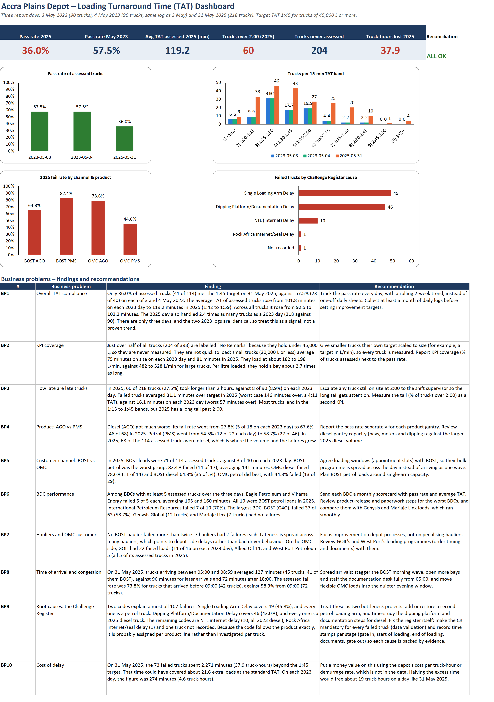

**Analysis sheets:** each holds a formula table, a chart, a finding and a recommendation.
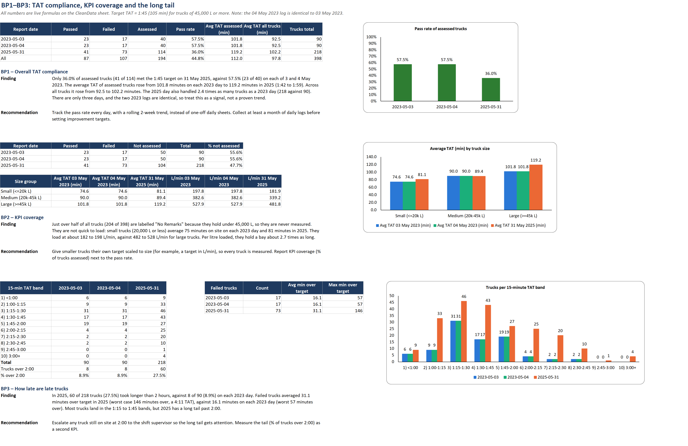
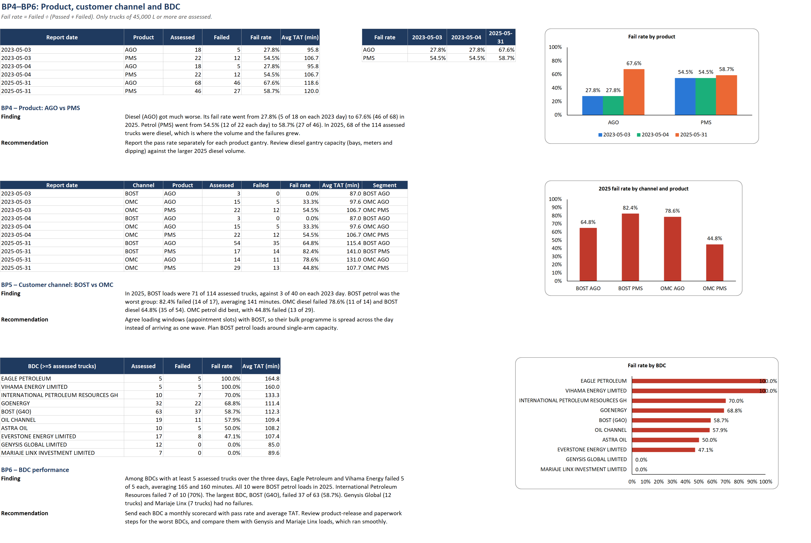
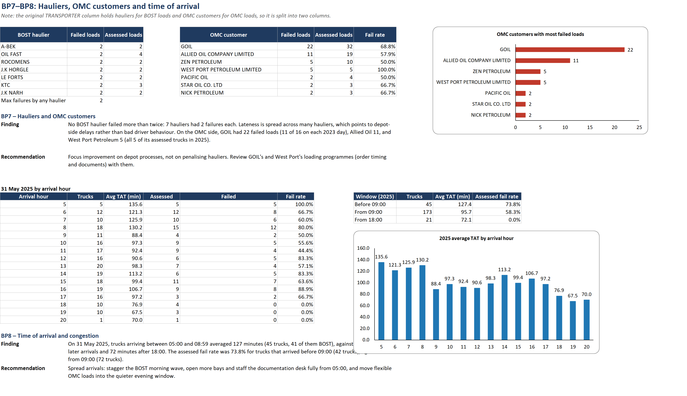
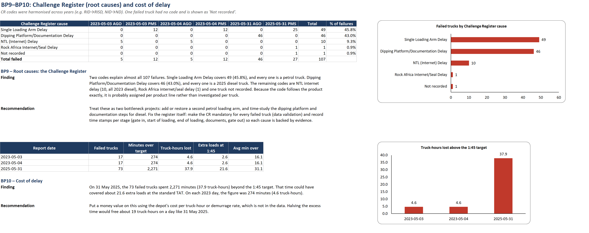

**Validation sheet:** the issue log and the reconciliation checks (all OK).
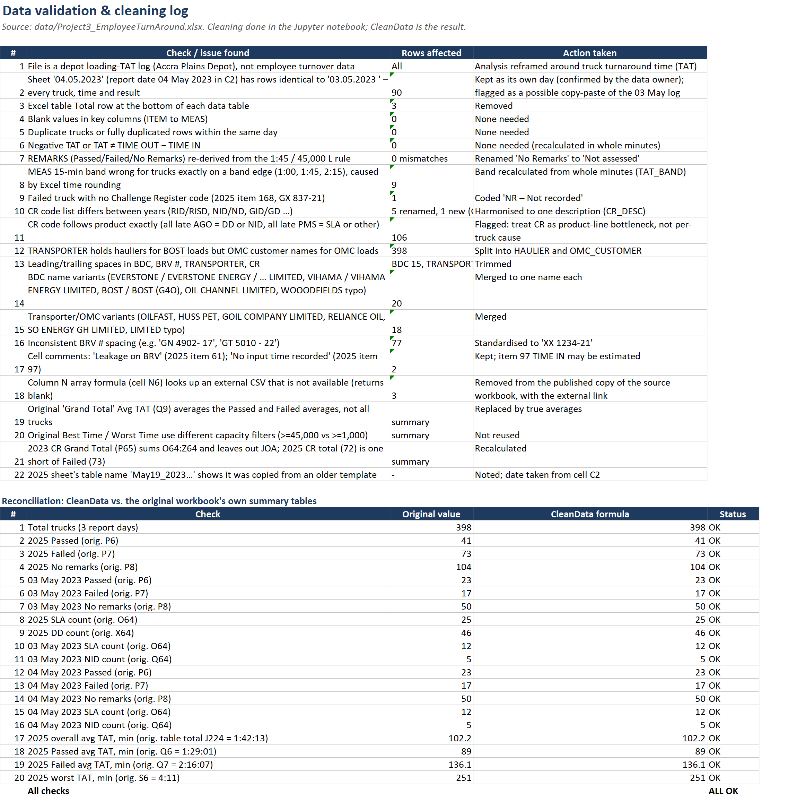

**CleanData:** the first rows of the 398-row cleaned table, which matches `data/Project3_LoadingTAT_CleanData_final.csv`.
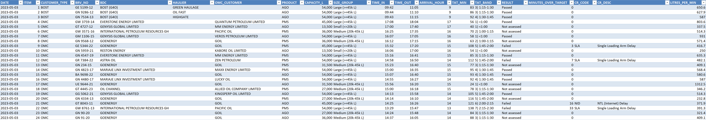

## 7. Limitations
* Only **three days** of data (3 and 4 May 2023, 31 May 2025), and the two 2023 logs are identical, so effectively one distinct 2023 day. The 2023-to-2025 changes are signals, not trends.
* TAT runs from gate-in to gate-out, so queueing, loading and paperwork time cannot be separated.
* The Challenge Register appears to be coded by product line, so cause analysis is indicative only.
* There is no cost data, so the cost of delay is given in truck-hours, not money.

## 8. How to reproduce
1. Install Python with `pandas`, `matplotlib`, `openpyxl` and `jupyter`.
2. Open `notebooks/Project3_LoadingTAT_Analysis_final.ipynb` and choose *Run All*. It reads `data/Project3_EmployeeTurnAround.xlsx`, rewrites `data/Project3_LoadingTAT_CleanData_final.csv` and re-creates the 16 charts in `images/`.
3. Open `excel/Project3_LoadingTAT_Analysis_final.xlsx`. The `CleanData` sheet holds the same 398 rows, and every analysis table is a COUNTIFS, AVERAGEIFS, SUMIFS or MAXIFS formula on it.
