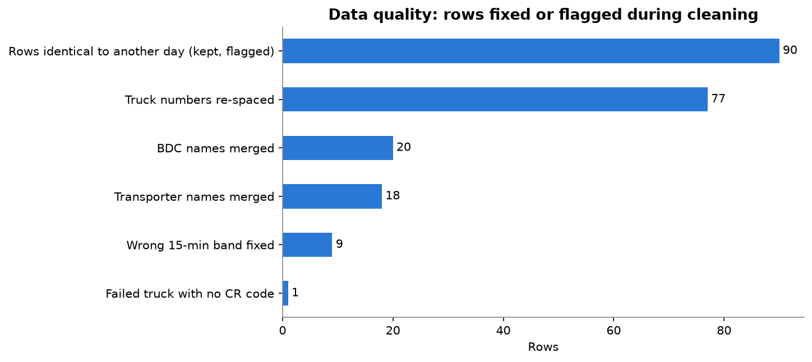

# Data cleaning notes

Source: `data/Project3_EmployeeTurnAround.xlsx` (sheets `31.05.2025`, `03.05.2023`, `04.05.2023`).
Cleaning code: `notebooks/Project3_LoadingTAT_Analysis_final.ipynb`, sections 2–3. Output: `data/Project3_LoadingTAT_CleanData_final.csv`.

## Validation and cleaning
**Process:** read both report sheets → compare category counts with the workbook's own summary tables → recompute every formula column from the raw times → fix the problems found → reconcile.

| Check | Result | Action |
|---|---|---|
| **04 May log repeats 03 May** | Sheet `04.05.2023` (dated 4 May 2023 in C2) has all 90 rows identical to 3 May: same trucks, times and results | Kept as its own day (confirmed by the data owner) and flagged. The real 4 May log may have been overwritten |
| Excel table total rows | 1 per sheet | Removed |
| Blanks in key columns, duplicate trucks, duplicate rows | None | – |
| TAT = TIME OUT − TIME IN, negative TATs | All 398 match; none negative | Recomputed in whole minutes |
| REMARKS vs the 1:45 / 45,000 L rule | 0 mismatches | "No Remarks" renamed "Not assessed" |
| **MEAS band on a band edge** | **9 rows** (5 in 2025, 2 on each 2023 day) at exactly 1:00, 1:45 or 2:15 placed one band too low (Excel time rounding) | Band recalculated |
| **Failed truck without a CR code** | **1** (2025 item 168, GX 837-21) | Coded "NR – Not recorded" |
| **CR code follows product** | Every late diesel truck = DD (2025) or NID (2023); every SLA code is petrol | Flagged: the codes describe product-line bottlenecks, not per-truck causes |
| CR code list changed between years | RID→RISD, NID→ND, GID→GD, TID→TD, BID→BD; GSD added | Harmonised descriptions |
| **TRANSPORTER has two meanings** | Hauliers on BOST rows; OMC customer names (GOIL, PUMA, STAR OIL…) on OMC rows | Split into HAULIER / OMC_CUSTOMER |
| Spaces and spelling variants | BDC: 15 rows with spaces, 20 rows renamed (e.g. EVERSTONE ×3 spellings, VIHAMA, BOST, WOOODFIELDS). Transporter: 45 rows with spaces, 18 renamed. BRV #: 77 re-spaced | Trimmed and merged |
| Cell comments | "Leakage on BRV" (2025 item 61); "No input time recorded" (2025 item 97) | Kept as notes |
| Workbook formula issues | Q9 "Grand Total" average = average of two averages. Best and worst time use different capacity filters. 2023 CR total omits JOA. 2025 CR total (72) ≠ Failed (73). Column N looks up an unavailable external CSV | Replaced by recalculated figures. The column-N formula and its external link were removed from the published copy of the source workbook |

**Reconciliation:** the workbook's `Validation` sheet compares 20 figures from the original summary tables (all three sheets) (Passed/Failed/No-remarks counts, CR counts, average and worst TAT) with formulas on `CleanData`. **All 20 show OK.**

## Cleaned columns
| Column | Meaning |
|---|---|
| DATE | Report date (from cell C2 of each sheet) |
| ITEM | Row number in the original sheet |
| CUSTOMER_TYPE | BOST (state strategic stock) or OMC (oil marketing company) |
| BRV_NO | Truck plate, standardised |
| BDC | Bulk distribution company that owns the product, names merged |
| HAULIER | Haulage firm (BOST loads only) |
| OMC_CUSTOMER | Oil marketing company (OMC loads only) |
| PRODUCT | AGO = diesel, PMS = petrol |
| CAPACITY_L | Truck size in litres |
| SIZE_GROUP | Small (≤20k L), Medium (20k–45k L), Large (≥45k L) |
| TIME_IN / TIME_OUT | Gate-in and gate-out times |
| ARRIVAL_HOUR | Hour of TIME_IN |
| TAT_MIN | Turnaround time in whole minutes |
| TAT_BAND | 15-minute band, recalculated |
| RESULT | Passed / Failed / Not assessed (under 45,000 L) |
| MINUTES_OVER_TARGET | Minutes above 1:45 for failed trucks, else 0 |
| CR_CODE / CR_DESC | Challenge Register delay code and harmonised description (NR = not recorded) |
| LITRES_PER_MIN | CAPACITY_L ÷ TAT_MIN |
