# Project 4 – Product Monitoring Book: analysis summary (final)

**Source file:** `data/Project4_ProductMonitoringBook.xlsx`. It was only read; all work was done on a copy.

## Repo structure
```
Project4_ProductMonitoringBook/
├── README.md
├── data/
│   ├── Project4_ProductMonitoringBook.xlsx              # source workbook (742 daily sheets, Combined, Summary, Dashboard)
│   ├── combined_raw.csv                                 # the original Combined sheet as recorded (14,943 rows)
│   └── Project4_ProductMonitoring_CleanData_final.csv   # cleaned data (14,984 rows, 916 report days)
├── excel/
│   └── Project4_ProductMonitoring_Analysis_final.xlsx   # analysis workbook: data quality, reconciliation, KPIs, breakdowns, findings
├── notebooks/
│   └── Project4_ProductMonitoring_Analysis_final.ipynb  # pandas: rebuild from 742 daily sheets, validate, clean, analyse
├── images/                                              # original dashboard, 10 workbook screenshots, 7 notebook charts
├── presentation/
│   └── Project4_ProductMonitoring_Presentation_final.pptx # 14-slide project deck with speaker notes
├── video/
│   ├── Project4_Walkthrough_final.mp4                   # narrated 1080p walkthrough (7:57)
│   └── Project4_Walkthrough_final.srt                   # subtitles
└── docs/
    └── data_cleaning_notes.md                           # how Combined was built, every check and fix, column dictionary
```

**What the data is:** a BOST *"Daily BDC Transfer Report"*: one sheet per working day, listing how much product each Bulk Distribution Company (BDC) moved.

- **AGO** is diesel and **PMS** is petrol.
- **KSI** means liftings at the Kumasi depot. **BUIPE** and **AKOSOMBO** mean transfers through those depots.
- The workbook never states a unit. The volumes look like litres: about 60% of non-zero entries are multiples of 54,000, a common road-tanker load.

---

## 1. Expected outcomes: what the workbook is built to produce

| Sheet | Contents |
|---|---|
| **742 daily sheets** (`09-09-2020` … `05-09-2023`) | Each is a copy of a template. The report date is in **G3**. An Excel Table in `B5:H..` (e.g. `September09_2020`) lists every BDC against 5 volume columns, and a `DATE` column (`=$G$3`). The table ends with a Total row and an AGO/PMS "TOTAL VOLUMES" block. |
| **BDC List** | Table `BDC_list`: the 21 BDCs. |
| **Combined** | Query table `July2020` (`A1:I14944`, 14,943 rows): all daily tables stacked, plus Year and Month Name columns. |
| **Summary** | `PivotTable1`: volume per BDC × 5 columns, with filters for DATE, Year and Month Name. Below it, GETPIVOTDATA KPIs: Kumasi Lifting 2,328,784,800; Buipe Transfers 582,773,500; Akosombo Transfers 146,206,000; PMS Liftings 1,344,470,800; AGO Liftings 1,713,293,500. |
| **Dashboard** | Two PivotCharts on `PivotTable1`: a clustered bar chart and a doughnut chart. |

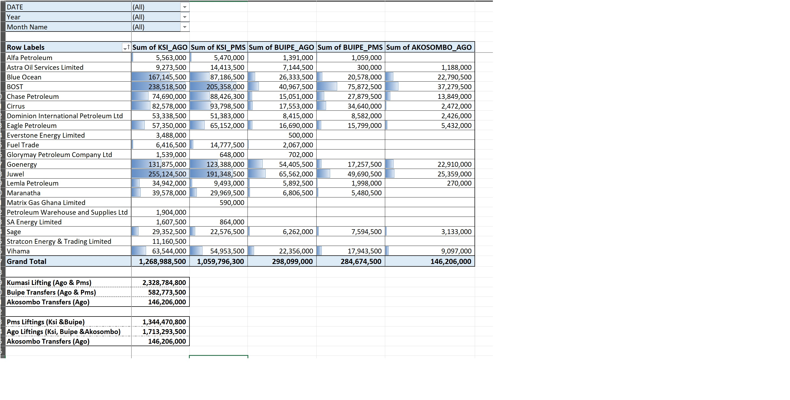

**Business questions the workbook answers:**

1. How much was lifted at Kumasi and transferred via Buipe and Akosombo?
2. How much AGO and how much PMS?
3. Which BDCs moved the most, and through which depot and product?
4. What happened on a chosen day, month or year? (Use the pivot filters.)

## 2. How the Combined sheet was built
The Combined sheet has no formulas. It is the output of a **Power Query append** (query `July2020`) that stacks all 742 daily tables with `Excel.CurrentWorkbook()`. The pivot, the Summary KPIs and the Dashboard all read it.

It matches the daily sheets on all 729 shared dates. But it holds 2,438 rows (Jan–Sep 2020) whose daily sheets are gone, and it misses the last two daily sheets, because the pivot was last refreshed on 4 Sep 2023. The step-by-step query logic is in [`docs/data_cleaning_notes.md`](docs/data_cleaning_notes.md).

## 3. Data analysis

### Business questions
| ID | Question |
|---|---|
| BQ1 | How much moved, through which depot, and what was the AGO vs PMS mix? |
| BQ2 | How concentrated is volume among BDCs? |
| BQ3 | Is volume growing or shrinking, and which months stand out? |
| BQ4 | Which BDCs are growing, declining or dormant? |
| BQ5 | Can management trust the Summary and Dashboard? |

### Cleaning and validation
Key issues: 2,438 rows only in Combined (kept and flagged), 2 daily sheets missing from Combined (added), 9 sheets whose date cell was not updated after copying (fixed from the sheet name), 1 exact duplicate row (removed), 1 stray backtick in a number column, and a trailing space in one BDC name on 918 rows. The full check list is in [`docs/data_cleaning_notes.md`](docs/data_cleaning_notes.md) and on the workbook's `Data_Quality` sheet.

The result is **14,984 clean rows** covering **916 report days** (3 Jan 2020 – 5 Sep 2023). The `Reconciliation` sheet proves the numbers tie out: original pivot = Combined sheet; Combined + the 2 new days = clean total; all checks show **OK**.

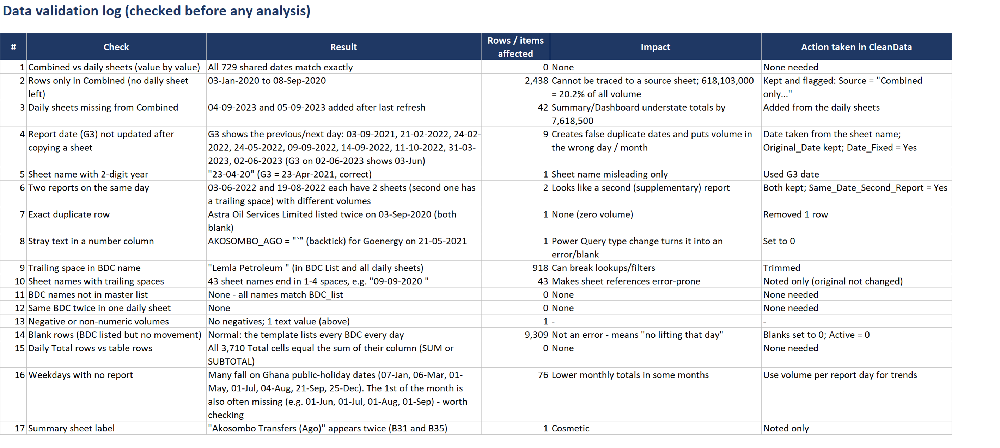
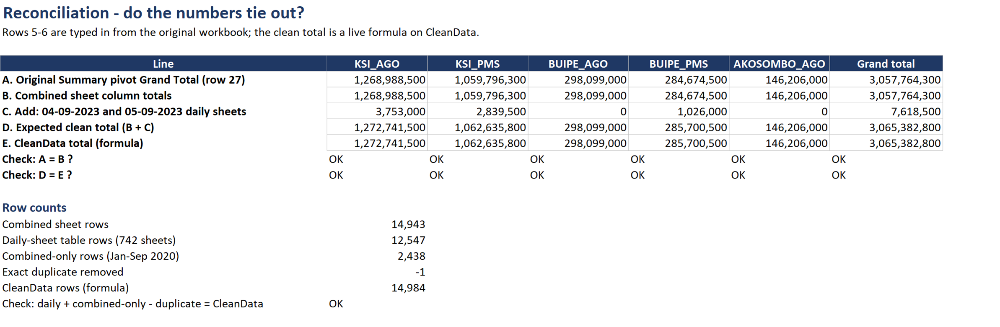

### KPIs
| KPI | Value |
|---|---|
| Total volume | **3,065,382,800** |
| AGO / PMS | 1,717,046,500 (56.0%) / 1,348,336,300 (44.0%) |
| Kumasi / Buipe / Akosombo | 2,335,377,300 (76.2%) / 583,799,500 (19.0%) / 146,206,000 (4.8%) |
| Average per report day | 3,346,488 |
| Top-5 BDC share | 68.4% |

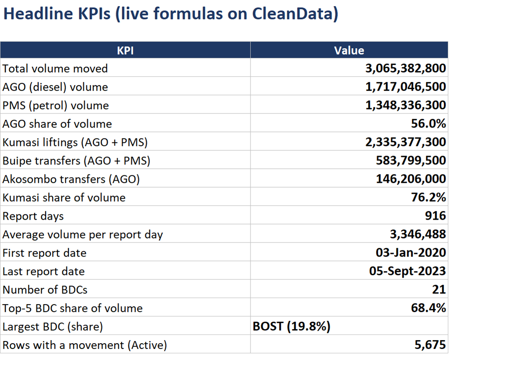
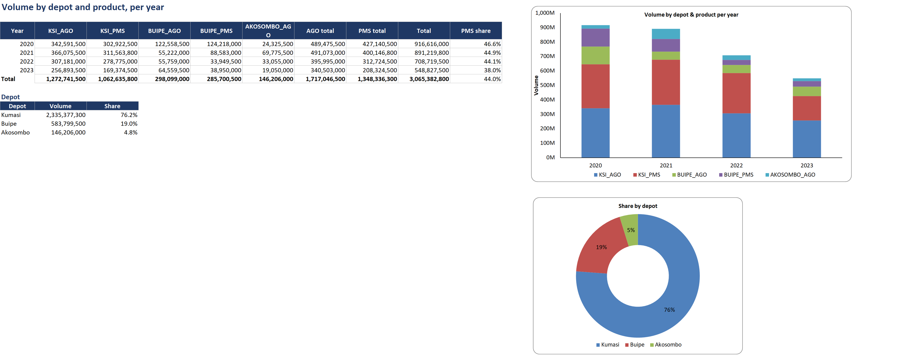

### Findings and recommendations
| Question | Finding | Recommendation |
|---|---|---|
| **BQ1 Volume & mix** | Kumasi handles 76.2% of all volume. The PMS share fell from 46.6% (2020) to 38.0% (2023). Buipe transfers fell from 246.8M (2020) to 89.7M (2022). | Put Kumasi first in capacity planning. Investigate the Buipe and PMS decline. |
| **BQ2 Concentration** | The top 5 BDCs (BOST, Juwel, Goenergy, Blue Ocean, Cirrus) move 68.4% of volume. BOST (19.8%) and Juwel (19.2%) alone account for 38.9%. | Track top-5 share monthly. Agree forward schedules with the two largest BDCs. |
| **BQ3 Trend** | Volume per report day: 3.57M (2020), 3.64M (2021), 2.98M (2022, −18.1%), 3.12M (2023, +4.7%). Jan–Aug totals: 593.9M, 593.5M, 499.6M, 541.2M. **June 2023:** AGO fell to 6,142,500, against 53,206,500 in May and 44,990,000 in July. AGO was zero on 14 of 21 report days. | Report trends per report day, since the number of report days per month varies from 18 to 26. Investigate and annotate June 2023. |
| **BQ4 Customer shifts** | BOST rose to 285,980,000 in 2023 (52.1% of the year), up from 10–15% before. Blue Ocean fell from 135,247,000 (2021) to 19,307,000 (2023), and Vihama from 57,664,500 to 5,712,500. Chase and Lemla moved nothing in 2023. | Find out why the private BDCs are declining. Add a "no movement for 30 days" alert. |
| **BQ5 Reliability** | Summary and Dashboard are stale: they miss 7,618,500, and 20.2% of their volume has no source sheet. Nine sheets carry the wrong date. The corrected total is 3,065,382,800, against 3,057,764,300 in the original Summary. | Refresh on open and show a "last refreshed" date. Derive G3 from the sheet name, or use one data-entry table. Keep the source sheet name in the query. Archive the 2020 source sheets. |

**Supporting charts:**
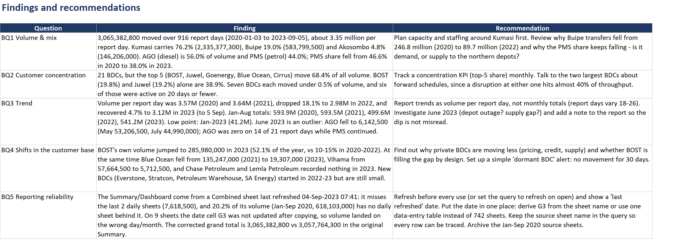
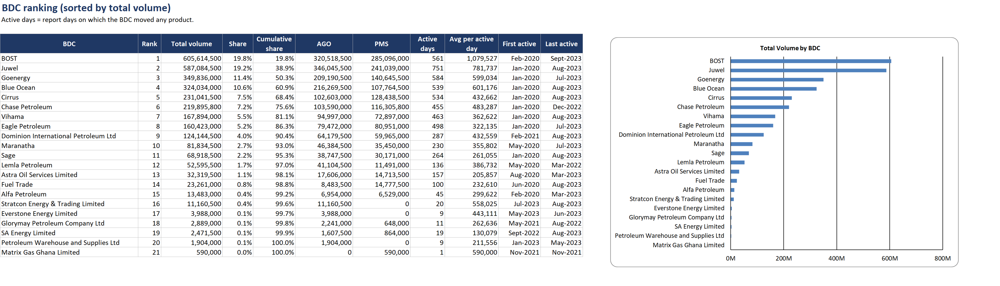
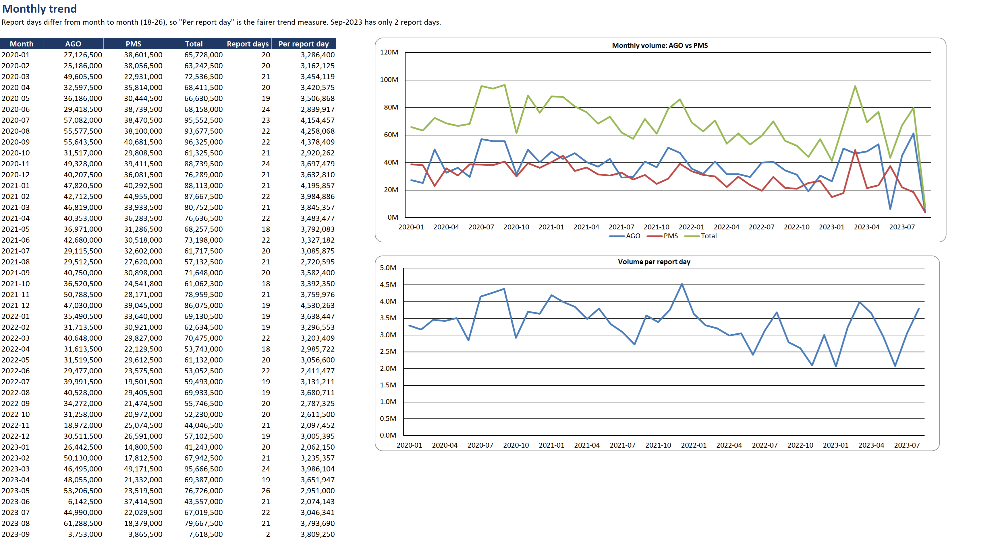
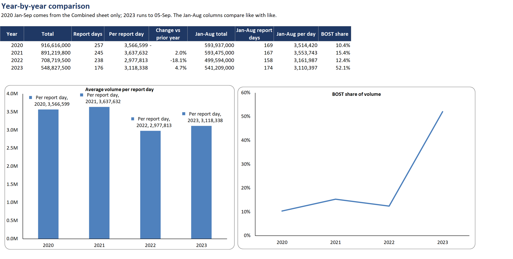
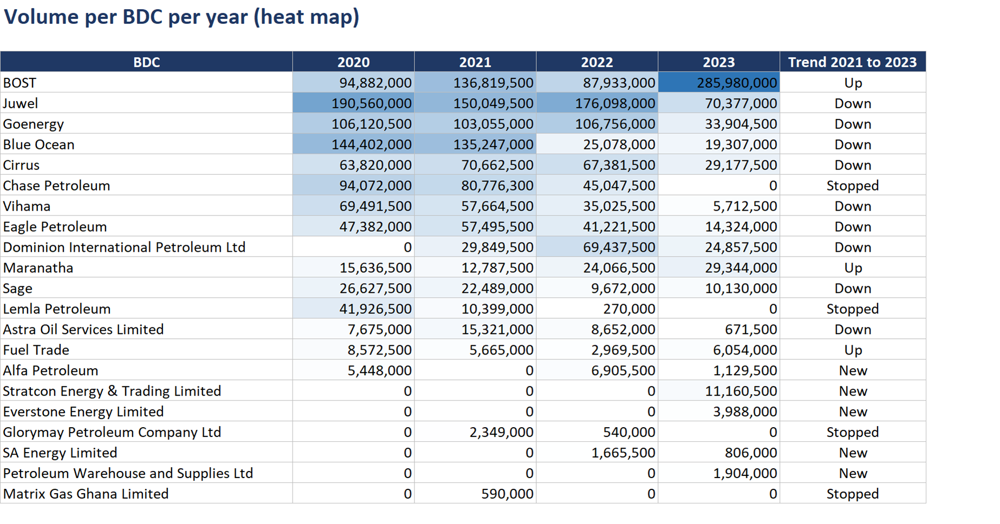

### Limitations
- The Jan–Sep 2020 data cannot be checked against source sheets.
- Units are not stated in the workbook.
- 2023 covers only 3 Jan to 5 Sep.
- 76 weekdays have no report. Many fall on Ghana public-holiday dates, and the 1st of the month is often missing too.

## 4. Python notebook
[`notebooks/Project4_ProductMonitoring_Analysis_final.ipynb`](notebooks/Project4_ProductMonitoring_Analysis_final.ipynb) rebuilds the clean data with pandas straight from the 742 daily sheets and the Combined sheet. It repeats every validation check and answers BQ1–BQ5 with charts. Its rebuild matches `data/Project4_ProductMonitoring_CleanData_final.csv` exactly: 14,984 rows, 916 report days and identical volumes for every date and BDC.

It also found one more data-quality issue: 11,371 of Combined's 14,943 dates are stored as plain Excel serial numbers rather than dates.

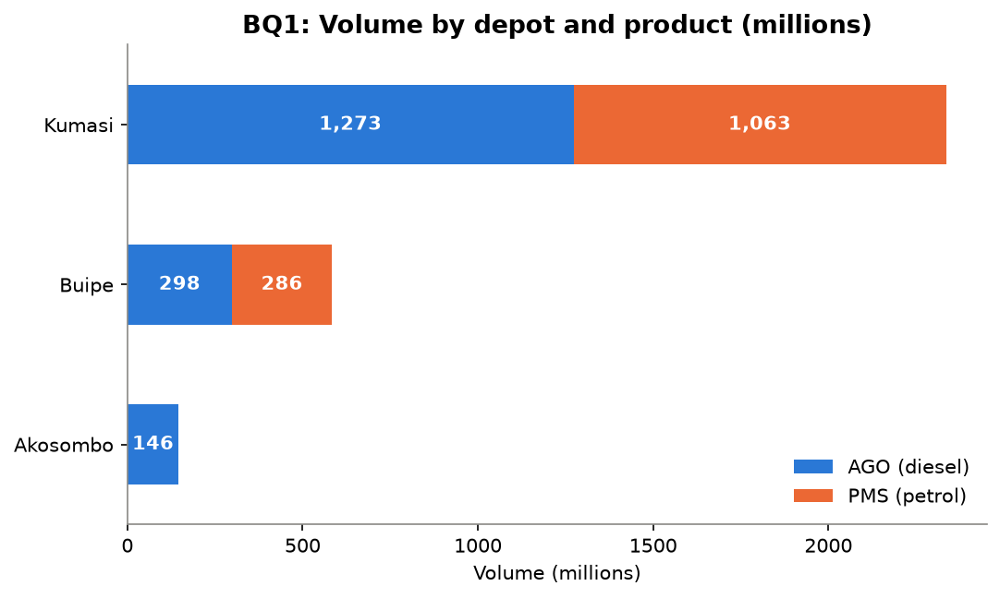
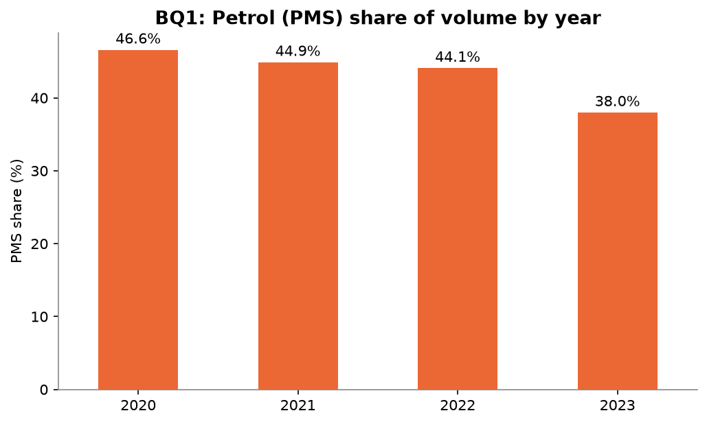
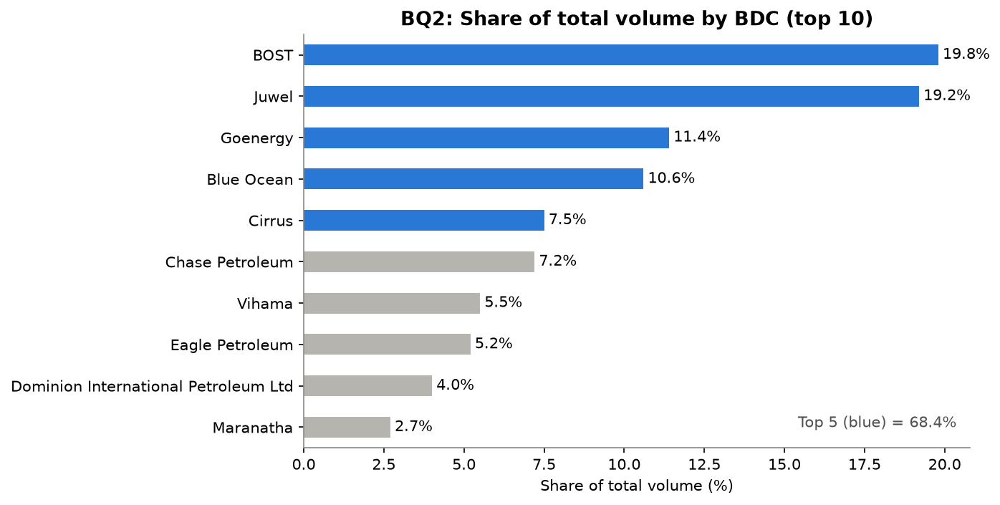
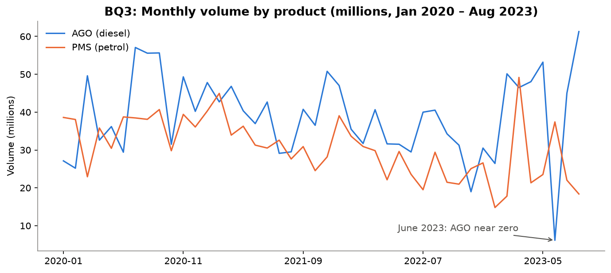
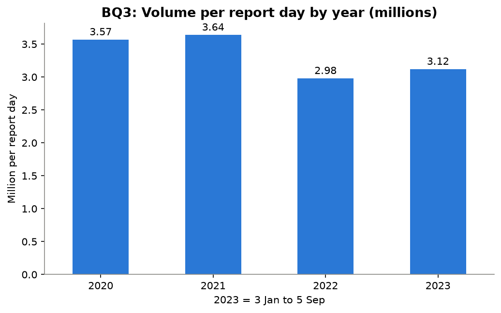
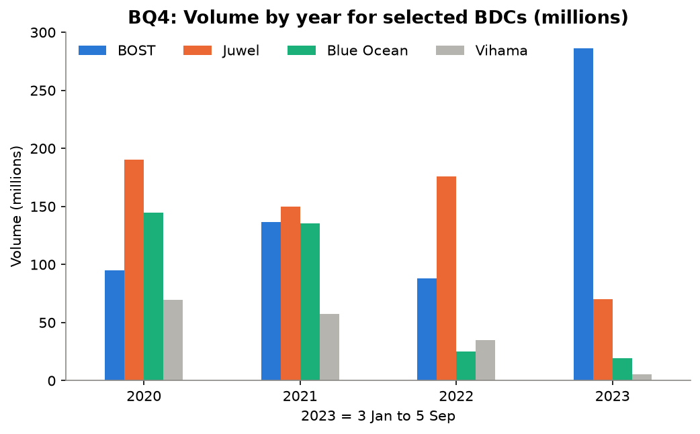
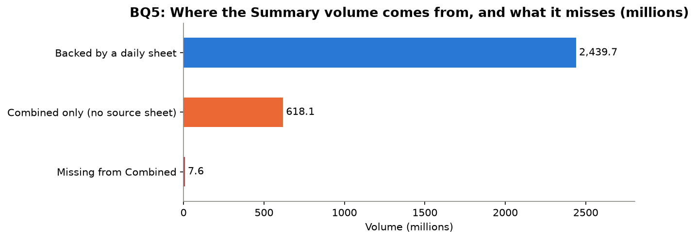

## 5. Presentation
[`presentation/Project4_ProductMonitoring_Presentation_final.pptx`](presentation/Project4_ProductMonitoring_Presentation_final.pptx) is a 14-slide deck with speaker notes. It covers what the data is, how the workbook is built, the five business questions, how the project was done, the validation results, the findings and the recommendations.

## 6. Walkthrough video
[`video/Project4_Walkthrough_final.mp4`](video/Project4_Walkthrough_final.mp4) is a narrated 1080p walkthrough (7:57) of the data, the cleaning and the findings, with subtitles in [`video/Project4_Walkthrough_final.srt`](video/Project4_Walkthrough_final.srt).

## 7. How to reproduce
1. Open `excel/Project4_ProductMonitoring_Analysis_final.xlsx`. The `CleanData` sheet holds the 14,984 clean rows, and every summary number is a live Excel formula on it.
2. Open `notebooks/Project4_ProductMonitoring_Analysis_final.ipynb` and choose *Run All* (Python with `pandas`, `matplotlib`, `openpyxl` and `jupyter`). It reads the source workbook, rebuilds the clean data, checks it against the CSV and re-creates the 7 charts in `images/`.
3. `data/Project4_ProductMonitoring_CleanData_final.csv` is the same table as a CSV. `data/combined_raw.csv` is the original Combined sheet, for comparison.
4. The source workbook is `data/Project4_ProductMonitoringBook.xlsx`; refresh its query in Excel to rebuild Combined.
