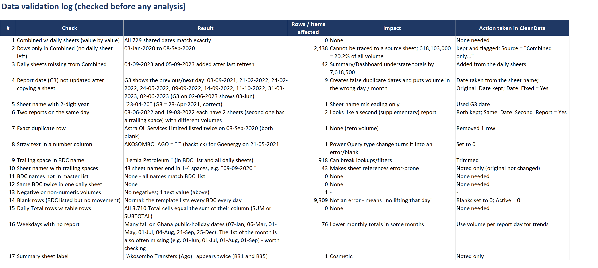
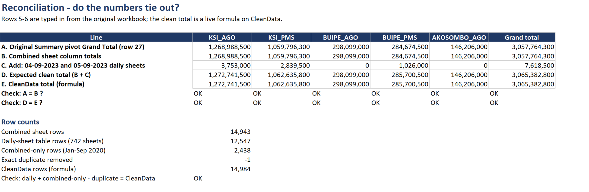

# Data cleaning notes

Source: `data/Project4_ProductMonitoringBook.xlsx`. Analysis workbook: `excel/Project4_ProductMonitoring_Analysis_final.xlsx` (sheets `How_Combined_Built`, `Data_Quality` and `Reconciliation`). Output: `data/Project4_ProductMonitoring_CleanData_final.csv`.

## How the Combined sheet was built

**Method: a Power Query *append*.** The other methods were ruled out: the Combined sheet has **zero formulas**, so it is not VLOOKUP, XLOOKUP, INDEX-MATCH, copy-paste or Data → Consolidate. The query `July2020` (connection "Query - July2020") works like this:

1. `Source = Excel.CurrentWorkbook()` lists every Excel Table in the workbook, with each table's rows in a `Content` column.
2. The query removes the tables that are not daily data. The filters are `not Text.Contains([Name],"BDC_list")`, `"Print_Area"`, `"Query"`, and `[Name] <> "July2020"`. The last one stops the output table from reading itself.
3. `Table.ExpandTableColumn(... {"BDC LIST","KSI_AGO","KSI_PMS","BUIPE_AGO","BUIPE_PMS","AKOSOMBO_AGO","DATE"})` stacks all 742 tables into one list.
4. The query drops rows where `BDC LIST = "Total"`, renames the columns, removes `Name`, and keeps only rows where `DATE <> null`. One quirk: AKOSOMBO_AGO is briefly renamed to "DATE" and then back again. The result is still correct.
5. It sets the column types and adds `Year = Date.Year([DATE])` and `Month Name = Date.MonthName([DATE])`.
6. It loads the result to **Combined!A1:I14944**. `PivotTable1` reads that table, the Summary KPIs use `GETPIVOTDATA` on the pivot, and the Dashboard charts read the pivot.

Inside each daily sheet:

- The `DATE` column is `=$G$3`.
- The Total row is `=SUBTOTAL(109,Table[col])` on earlier sheets and `=SUM(Table[col])` on later ones.
- `=SUMIF(Table[[#Headers],[KSI_AGO]:[AKOSOMBO_AGO]],"*"&"AGO",Table[[#Totals],...])` adds every total whose header ends in "AGO" (392 sheets have this block).

**Is Combined up to date?** Value by value, it matches the daily sheets on all **729 shared dates**. However:

- It holds **2,438 rows (3 Jan – 8 Sep 2020, 618,103,000)** whose daily sheets are no longer in the workbook.
- It is **missing the 04-09-2023 and 05-09-2023 sheets** (7,618,500), because the pivot was last refreshed on 4 Sep 2023 at 07:41.

## Checks and fixes (full log on the `Data_Quality` sheet)
| Issue | Found | Action |
|---|---|---|
| Rows only in Combined (no source sheet) | 2,438 rows, Jan–Sep 2020 | Kept and flagged in `Source` |
| Daily sheets not yet in Combined | 2 sheets (42 rows) | Added |
| Date cell G3 not updated after copying a sheet | 9 sheets (e.g. sheet `03-09-2021` says *Thursday, 2 September 2021*) | Used the sheet-name date; original kept in `Original_Date` |
| Sheet name with a 2-digit year | `23-04-20` | Used G3 (23-Apr-2021) |
| Two reports for one day | 03-06-2022 and 19-08-2022 | Both kept and flagged |
| Exact duplicate row | 1 (Astra, 3 Sep 2020, zero volume) | Removed |
| Text in a number column | 1 backtick in AKOSOMBO_AGO (Goenergy, 21-05-2021) | Set to 0 |
| Trailing space in a name | "Lemla Petroleum " (918 rows) | Trimmed |
| Sheet names with trailing spaces | 43 | Noted |
| Unknown BDC names, duplicate BDC in a sheet, negative values, Total-row errors | none | — |
| Blank rows (no movement that day) | 9,309 | Set to 0 (normal) |

The result is **14,984 clean rows** covering **916 report days** (3 Jan 2020 – 5 Sep 2023). The `Reconciliation` sheet proves the numbers tie out: original pivot = Combined sheet; Combined + the 2 new days = clean total; all checks show **OK**.

## Cleaned columns
| Column | Meaning |
|---|---|
| Date, Year, Month, Month_No, Weekday | Report date (from the sheet name where the date cell was wrong) and its parts |
| BDC | Bulk Distribution Company, trailing spaces trimmed |
| KSI_AGO, KSI_PMS | Liftings at the Kumasi depot (diesel, petrol) |
| BUIPE_AGO, BUIPE_PMS | Transfers through Buipe (diesel, petrol) |
| AKOSOMBO_AGO | Transfers through Akosombo (diesel) |
| AGO_Total, PMS_Total, Total | Row totals by product and overall |
| Active | 1 if the BDC moved any product that day |
| Date_Flag | 1 on one row per report day, used to count report days |
| BDC_Active_Day | 1 once per BDC per active day, so a second report for the same day is not double-counted |
| Source | `Daily sheet`, or `Combined only` for the Jan–Sep 2020 rows whose sheets are gone |
| Source_Sheet | Name of the daily sheet the row came from |
| Original_Date | The date as written in the sheet's G3 cell |
| Date_Fixed | `Yes` where the date was corrected from the sheet name (159 rows) |
| Name_Trimmed | `Yes` where a trailing space was removed from the BDC name (918 rows) |
| Stray_Text | `Yes` on the row where a backtick in a number cell was set to 0 (1 row) |
| Same_Date_Second_Report | `Yes` on rows from the second report for the same day (68 rows) |
