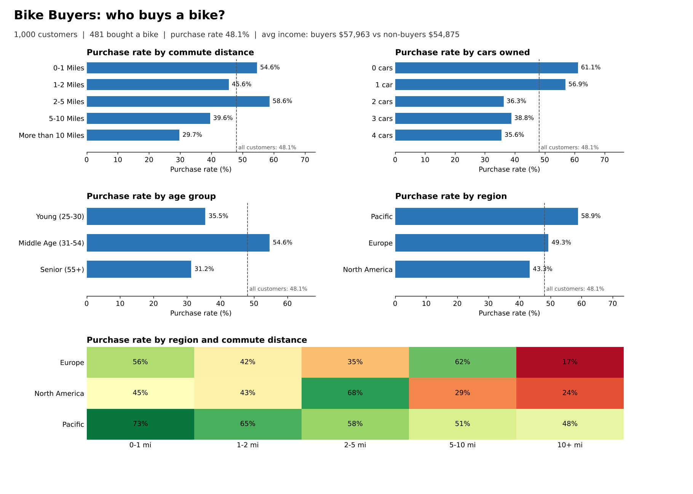
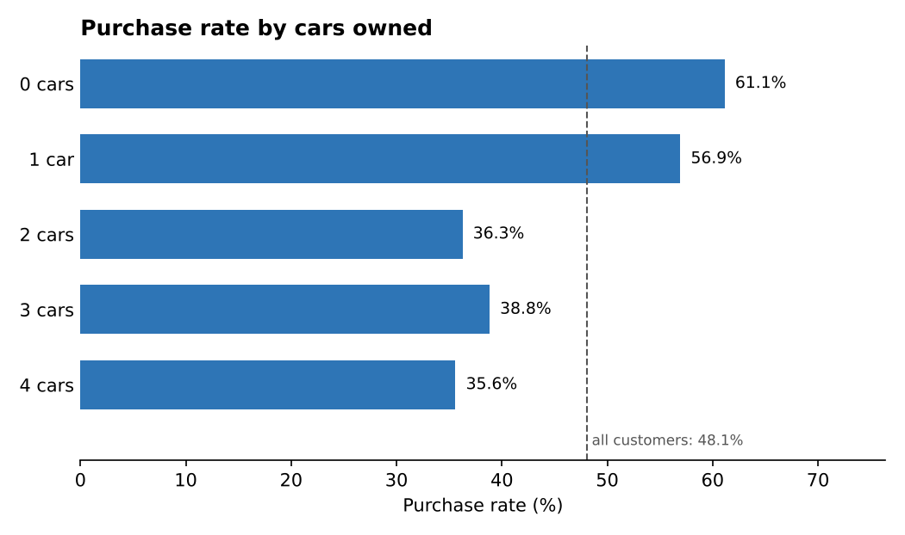
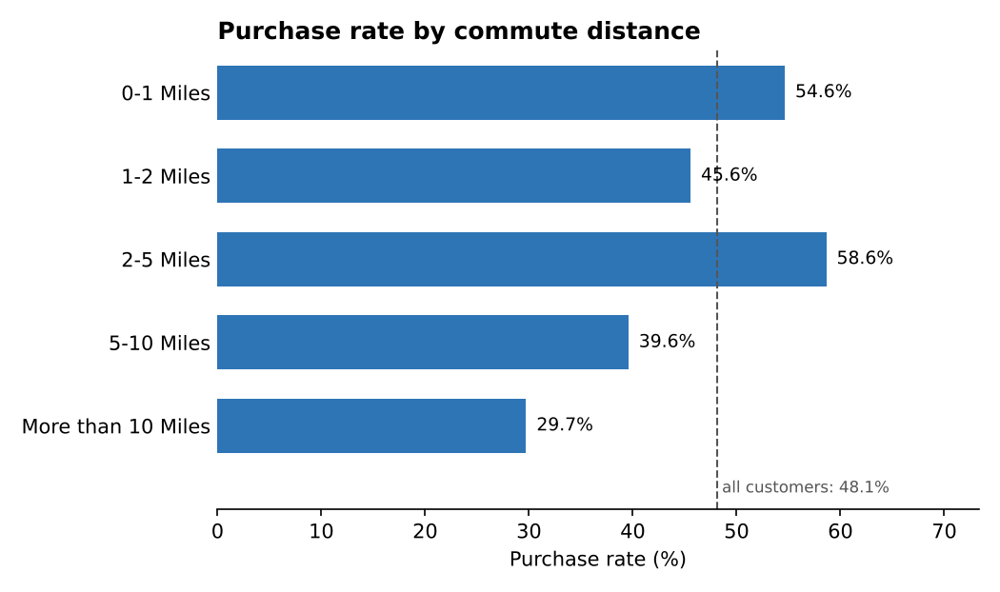
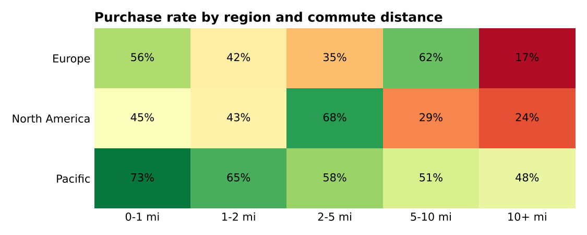

# Bike Buyers Analysis: Who Buys a Bike?

An Excel analysis of 1,000 customers that looks at which demographic and lifestyle traits are linked to buying a bike.

## Business question

A bike retailer wants to know **which customers are most likely to buy a bike**, so it can focus marketing on the right people and places.

## Dataset

- **Source:** the "Bike Buyers" practice dataset from a Udemy Excel data analysis course. I extended the course project with my own purchase-rate analysis, a data quality fix and written insights.
- **Size:** 1,026 raw rows. After removing 26 duplicates, 1,000 unique customers remain.
- **Fields:** marital status, gender, income, children, education, occupation, home ownership, cars, commute distance, region, age and whether the customer bought a bike.

| File | Description |
|---|---|
| `data/bike_buyers_raw.csv` | Original data, as received |
| `data/bike_buyers_clean.csv` | Cleaned data used for the analysis |
| `excel/Bike_Buyers_Analysis.xlsx` | Workbook with the cleaning steps, pivot tables, dashboard and the **Bike Analysis** sheet |

## Key findings

Overall, **48.1%** of customers bought a bike (481 of 1,000).

| Finding | Purchase rate |
|---|---|
| Customers with **no car** buy far more than those with 2 or more cars | **61.1%** vs **36.6%** |
| Rate peaks for **2-5 mile** commutes and is lowest for commutes **over 10 miles** | **58.6%** vs **29.7%** |
| **Middle-aged** customers (31-54) buy more than younger (25-30) or older (55+) customers | **54.6%** vs **35.5%** / **31.2%** |
| **Pacific** leads, ahead of Europe and North America | **58.9%** vs **49.3%** / **43.3%** |
| **Single** customers buy more than **married** customers | **54.1%** vs **42.9%** |
| Bachelor's or graduate degree vs partial high school | **54.8%** vs **26.3%** |
| Gender and home ownership make **almost no difference** | Women 48.9%, men 47.4%; owners 47.6%, non-owners 49.2% |

Buyers earn slightly more on average than non-buyers ($57,963 vs $54,875) and are slightly younger (42.9 vs 45.3 years).

  
  

### Region and commute together

Pacific customers with a 0-1 mile commute buy at **73%**, the highest of any group. European customers commuting more than 10 miles buy at only **17%**, though that group has just 18 customers.

## Recommendations

1. **Target short-distance commuters (under 5 miles) who own 0-1 cars.** This is the strongest buying profile in the data.
2. **Put more marketing spend into the Pacific region,** and test why North America converts less well.
3. **Aim messaging at the 31-54 age group,** for example around commuting and fitness.
4. **Don't split campaigns by gender or home ownership.** Those traits barely change the purchase rate.

## Data cleaning

- Removed **26 duplicate rows**.
- Replaced codes with full words (`M`/`S` → Married/Single, `M`/`F` → Male/Female).
- Added an **age bracket** column (Adolescent, Middle Age, Old).
- **Fixed a formula bug.** The original age bracket formula labelled all **25 customers aged 31** as "Invalid", because the formula tested `>31` and `<31` but never `=31`. The fix places them in Middle Age (31-54).

See [`docs/data_cleaning_notes.md`](docs/data_cleaning_notes.md) for details.

## Tools and techniques

- **Microsoft Excel:** pivot tables and pivot charts, slicers, `COUNTIFS`, `AVERAGEIFS`, `IFERROR`, nested `IF`, conditional formatting (colour scales) and clustered column charts
- Interactive dashboard with slicers for marital status, region, education and gender
- An analysis sheet driven entirely by formulas, so every table and chart updates when the data changes

## How to use

1. Download `excel/Bike_Buyers_Analysis.xlsx`.
2. Open the **Dashboard** tab and use the slicers to filter.
3. Open the **Bike Analysis** tab for purchase rates by every customer trait, the age profile, the region × commute view and the buyer vs non-buyer profile.

## Limitations

- This is a single sample of 1,000 customers, so the results show **associations, not causes**.
- Some groups are small. For example, only 59 customers own 4 cars, and some region × commute cells have fewer than 20 (Europe, 5-10 miles, has 16). Rates for small groups can swing a lot.
- The dataset was built for teaching and has no dates, so trends over time can't be analysed.

## Author

**Daniel Dadzie Appiah** · GitHub: [@danivelve](https://github.com/danivelve)
